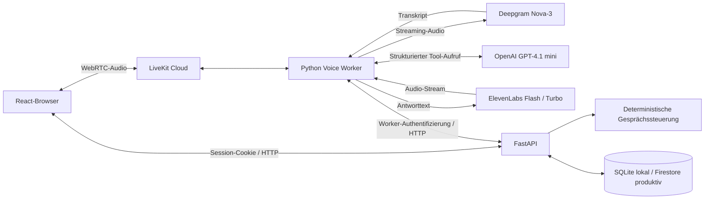
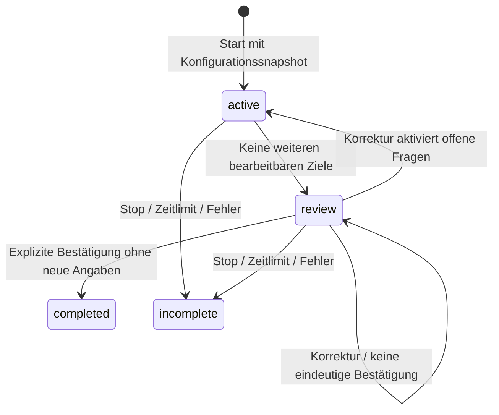

# Founder Studio – Technischer Guide

Stand: 9. Oktober 2026. Diese Anleitung beschreibt den implementierten Stand im Repository. Sie enthält keine Zugangsdaten. Für die Präsentation siehe [Demo-Guide](DEMO_GUIDE.md).

## 1. Architektur



| Komponente | Aufgabe | Implementierung |
| --- | --- | --- |
| Frontend | Admin, Interview, Historie, Auswertung | React, TypeScript, Vite; `frontend/src/` |
| API | Authentifizierung, Konfiguration, Sitzungen, Speicherung | FastAPI und Pydantic; `app/main.py` |
| Controller | Antwortziele, Nachfragen, Bedingungen, Abschluss | `app/planner.py`; Legacy-Pfad in `app/interview.py` |
| Auswertung | Deterministischer Match, Vollständigkeit, Statistik | `app/analysis.py` |
| Voice Worker | Echtzeit-Audio und Anbieter-Orchestrierung | LiveKit Agents **1.8.5**; `voice/worker.py` |
| Extraktion | Ein strukturierter Modellaufruf pro User-Turn | `voice/extraction.py` |
| Persistenz | Atomare Dokumentänderungen | `app/store.py` |

Der Browser kennt keine Provider-Schlüssel. Er erhält ein fünf Minuten gültiges LiveKit-Verbindungstoken für einen Interviewraum und eine Identität; als veröffentlichbare Quelle ist das Mikrofon zugelassen. Die Tokenlaufzeit ist nicht die maximale Gesprächsdauer.

## 2. Lokale Ersteinrichtung unter Windows

Voraussetzungen: Python 3.11 oder neuer, Node.js/npm passend zum vorhandenen Frontend, Internetzugriff auf die vier Anbieter sowie Edge oder Chrome. Die bisherige Umgebung wurde mit Python 3.11 und installiertem Edge getestet; im Projekt wird Node.js 22.22+ empfohlen.

Alle Befehle beginnen im Repository-Hauptverzeichnis, sofern kein anderes Verzeichnis angegeben ist.

```powershell
python -m venv .venv
.venv/Scripts/python -m pip install -e '.[test,voice]'
Set-Location frontend
npm ci
npm run build
Set-Location ..
```

`frontend/package-lock.json` fixiert die Frontend-Abhängigkeiten. `requirements-lock.txt` dokumentiert die geprüfte Windows-Python-Umgebung. Das LiveKit Agents SDK ist zusätzlich in `pyproject.toml` auf 1.8.5 festgelegt.

Die lokale Konfiguration nur anlegen, falls noch keine `.env` existiert:

```powershell
if (-not (Test-Path -LiteralPath .env)) {
    Copy-Item -LiteralPath .env.example -Destination .env
}
```

Eine bereits konfigurierte `.env` nicht überschreiben.

## 3. Konfiguration und Schlüssel

| Variable | Bedeutung / lokaler Wert |
| --- | --- |
| `ENVIRONMENT` | `development` |
| `PERSISTENCE_BACKEND` | `sqlite` |
| `DATABASE_PATH` | `.local/interviews.db` |
| `PUBLIC_ORIGIN` | `http://localhost:8000`; muss zur im Browser verwendeten Origin passen |
| `BACKEND_URL` | `http://localhost:8000`; Adresse der API aus Sicht des Workers |
| `LIVEKIT_URL` | WebSocket-URL des LiveKit-Projekts |
| `LIVEKIT_API_KEY`, `LIVEKIT_API_SECRET` | Zugangsdaten desselben LiveKit-Projekts für API und Worker |
| `DEEPGRAM_API_KEY` | Geheimer API-Schlüssel für Streaming-Spracherkennung |
| `OPENAI_API_KEY` | Geheimer API-Schlüssel mit Zugriff auf das konfigurierte Modell |
| `LLM_MODEL` | Aktueller Standard: `gpt-4.1-mini` |
| `ELEVENLABS_API_KEY` | Geheimer Schlüssel, ausdrücklich **nicht** die Key-ID |
| `SESSION_SECRET` | Stabiles Geheimnis zum Signieren von Login- und Einladungstokens |
| `WORKER_SECRET` | Separates Geheimnis für interne Worker-Aufrufe |
| `ADMIN_PASSWORD` | Lokal optional; ein gesetzter Wert deaktiviert die passwortlosen Vorschauzugänge |
| `FIRESTORE_PROJECT` | Google-Cloud-Projekt-ID; bei SQLite leer lassen |
| `FIRESTORE_DATABASE` | `(default)`; nur beim Firestore-Backend relevant |

`SESSION_SECRET` und `WORKER_SECRET` unabhängig erzeugen, beispielsweise jeweils mit:

```powershell
.venv/Scripts/python -c "import secrets; print(secrets.token_urlsafe(48))"
```

Diese Ausgabe ist geheim. Die Werte nur lokal übernehmen, nicht in Dokumentation, Chat oder Git kopieren. Ein geändertes `SESSION_SECRET` macht bestehende Login- und Einladungstokens ungültig; die Datenbank wird dadurch nicht gelöscht.

**ElevenLabs-Berechtigungen für die aktuelle Anwendung:** „Restrict Key“ aktivieren, „Text to Speech“ auf „Access“, andere Endpunkte auf „No Access“. „Voices → Read“ ist derzeit nicht nötig, weil die Voice-ID manuell gesetzt und keine Stimmenliste abgerufen wird. Ein Kreditlimit kann zusätzlich gesetzt werden.

Die Voice-ID wird **im Admin-Interface** veröffentlicht und mit der Konfiguration gespeichert, nicht als Umgebungsvariable. Die bereits live getestete Standard-ID `JBFqnCBsd6RMkjVDRZzb` gehört zur Teststimme George; ob eine Stimme im jeweiligen Account verfügbar ist, muss die Hörprobe bestätigen.

Nach Änderungen an `.env` API **und** Worker neu starten. Die Anbieterabrechnung erfolgt getrennt. Eine ChatGPT-Nutzung ersetzt nicht den API-Zugang. Für aktuelle Preise die jeweiligen Anbieter prüfen; dieser Guide fixiert keine Tarife.

## 4. Start und Funktionsprüfung

Zunächst die lokalen Sprachaktivitäts-/Turn-Detector-Modelle laden:

```powershell
.venv/Scripts/python -m livekit.agents download-files
```

**Terminal A – API und gebautes Frontend:**

```powershell
.venv/Scripts/python -m uvicorn app.main:app --host 127.0.0.1 --port 8000
```

**Terminal B – Worker:**

```powershell
.venv/Scripts/python -m voice.worker start --log-level warn
```

Für Entwicklung ist alternativ `python -m voice.worker dev` mit der Projekt-venv möglich. Nur eine Worker-Instanz für diese lokale Prüfung starten, damit Jobzuordnung und Logs eindeutig bleiben.

| Adresse | Zweck |
| --- | --- |
| `http://localhost:8000` | Anwendung |
| `http://localhost:8000/api/health` | API-Liveness, keine Providerprüfung |
| `http://localhost:8000/docs` | Interaktive API-Dokumentation |
| `http://localhost:8000/openapi.json` | API-Schema |
| `http://127.0.0.1:8081/` | Health-Endpunkt des lokalen Workers bei Standard-Portbelegung |

`voice_ready` in `/api/bootstrap` prüft nur, ob benötigte Einstellungen und eine Voice-ID vorhanden sind. Es garantiert weder gültige Zugangsdaten noch einen erreichbaren Worker. Der Browser wartet nach dem Raumbeitritt bis zu etwa 30 Sekunden auf einen Agenten.

Danach: als Admin anmelden, Voice-ID eintragen, **„Stimme probehören“**, **„Version veröffentlichen“**. Als Startup ein neues Interview starten. Mikrofonzugriff benötigt localhost oder HTTPS. Wegen der Origin-Prüfung nicht beliebig zwischen `localhost` und `127.0.0.1` als Browseradresse wechseln.

Für Vite-Entwicklung im Ordner `frontend` `npm run dev` verwenden und `PUBLIC_ORIGIN=http://localhost:5173` setzen. API neu starten. Vite leitet `/api` an Port 8000 weiter.

## 5. Verarbeitung eines gesprochenen Beitrags

1. Der Browser veröffentlicht Mikrofon-Audio über WebRTC.
2. Deepgram Nova-3 liefert laufende Transkription. Silero VAD und der lokale LiveKit-Turn-Detector helfen bei der Erkennung von Sprechpausen und Gesprächsenden.
3. Nach einem abgeschlossenen User-Turn ruft der Worker das konfigurierte OpenAI-Modell auf. Timeout: sieben Sekunden; keine automatischen SDK-Retries für diesen Modellaufruf.
4. Das Modell muss `record_interview_observations` mit strukturierten Argumenten aufrufen. Neue Interviews verwenden `GoalExtraction` ohne die früheren Felder `facts` und `observations`.
5. FastAPI validiert die Angaben und schreibt Transkript, Antworten und Fortschritt atomar. Der Controller bestimmt die nächste Frage oder die Abschlussprüfung.
6. Erst nach erfolgreicher Backend-Antwort geht der kanonische Antworttext an ElevenLabs. Dessen Audio wird über LiveKit zum Browser gestreamt.
7. Tatsächlich gesprochene Assistant-Beiträge werden über LiveKits Conversation-Events gespeichert. Andere Ereignisse wie `AgentHandoff` werden ignoriert.

**Streaming-Grenze:** STT und Audioausgabe arbeiten als Streams. Die strukturierte LLM-Antwort wird derzeit vollständig empfangen und validiert. Es gibt kein Token-für-Token-Streaming der Modellantwort in die Sprachausgabe.

Es gibt keinen zweiten LLM-Aufruf zur Formulierung der nächsten Frage. Fragen und Rückfragen stammen aus der veröffentlichten Konfiguration; das Modell kann eine kurze Reaktion ergänzen. Spekulative Generierung ist deaktiviert, um keinen Interviewzustand aufgrund eines noch nicht abgeschlossenen Turns zu verändern.

## 6. Gesprächssteuerung

Neue Interviews verwenden `planner_version=2`. Historische Interviews behalten ihren bisherigen Controller. Die veröffentlichte Konfiguration wird bei Bedarf migriert; alte Interview-Snapshots werden nicht nachträglich umgestellt.

### Antwortziele

Ein `AnswerGoal` enthält:

| Feld | Zweck |
| --- | --- |
| `key`, `topic`, `label` | Stabiler Schlüssel, einer von sieben Themenbereichen, Anzeigename |
| `criteria` | Was eine ausreichende Antwort enthalten muss |
| `question`, `clarification` | Redaktionelle Frage und Rückfrage |
| `required`, `enabled` | Pflichtstatus und Aktivierung |
| `max_followups` | 0–3 Rückfragen, standardmäßig 1 |
| `kind`, `choices`, `unit` | Freitext, Kategorie oder Zahl; ggf. Optionen und Einheit |
| `condition` | Relevanz abhängig von einer früheren Auswahlantwort |

Bis zu 40 Ziele sind möglich. Mindestens ein aktives Pflichtziel ist erforderlich. Bedingungen dürfen nur frühere aktive Auswahlziele referenzieren; ungültige Referenzen und Zyklen werden verhindert. Pflichtziele werden vor optionalen Zielen bearbeitet. Frei vorweggenommene Antworten können spätere Fragen bereits erfüllen.

Interne Antwortzustände sind `open`, `partial`, `answered` und `unknown`. Im Bericht kommen `not_applicable` für eine nicht zutreffende Bedingung und `blocked` für eine ungeklärte Voraussetzung hinzu. Ungeklärt ist nicht automatisch nicht relevant. Teilantworten bleiben nach ausgeschöpftem Rückfragenbudget erhalten.

### Extraktion und Belege

Jede extrahierte Antwort trägt `goal_key`, Status, Wert und ein exaktes Zitat aus dem aktuellen User-Turn. Zahlen-/Auswahlziele benötigen bei vollständiger Antwort zusätzlich einen passenden typisierten Wert. Doppelte Schlüssel, ungültige Typen und nicht vorkommende Zitate werden abgewiesen.

Das schützt vor unbelegten Schreibvorgängen, garantiert aber nicht, dass jede Interpretation semantisch richtig ist. Ebenso kann der erkannte User-Text bereits STT-Fehler enthalten. Deshalb bleiben Transkriptbelege und Abschlussprüfung wichtig.

### Sitzungszustände



`completed` bedeutet, dass das Ergebnis bestätigt wurde. Es bedeutet nicht automatisch, dass alle Pflichtangaben bekannt sind: explizit unbekannte Angaben und ausgeschöpfte Rückfragen bleiben im Ergebnis sichtbar.

## 7. Match und Auswertung

Ein `MatchProfile` enthält einen Namen und Regeln mit Gewicht 1–10. Kategorie-Regeln prüfen akzeptierte Werte; Zahlen-Regeln prüfen ein Intervall einschließlich der Grenzen. Freitextziele werden nicht frei durch ein Modell benotet.

```text
Match = 100 × Gewicht passender Kriterien / Gewicht bewertbarer Kriterien
Abdeckung = 100 × Gewicht bewertbarer Kriterien / Gewicht relevanter Kriterien
Vollständigkeit = 100 × beantwortete relevante Pflichtziele / relevante Pflichtziele
```

Die angezeigten Werte werden auf ganze Zahlen gerundet. Unbekannte, partielle oder blockierte Antworten liefern keinen negativen Match, senken aber die Belegabdeckung. Nicht relevante Kriterien entfallen. Ohne bewertbare Kriterien ist der Score `null`, nicht null Prozent. Ohne hinterlegte Regeln gibt es keinen Match-Score.

Beispiel: Sektor SaaS mit Gewicht 3 passt; Entwicklungsphase mit Gewicht 1 passt nicht. Ergebnis: 75 Match und 100 % Abdeckung. Fehlt die Phase, ergeben sich 100 Match bei 75 % Abdeckung.

Der Bericht bietet Zielzustände, Belegverknüpfungen, Themenfortschritt, Wortzahlen, Beitragszahlen, Rückfragen und Unterbrechungen. Wortanteile sind keine gemessene Sprechzeit. Das Transkript wird chronologisch mit Sprecher, Zeitstempel und Unterbrechungsmarkierung ausgegeben. Export ist als Text und JSON möglich.

## 8. Datenhaltung, Authentifizierung und API

SQLite speichert lokal dauerhaft in `DATABASE_PATH`; Konfigurationen liegen ebenfalls in der Datenbank. `.env` enthält keine veröffentlichte Fragenkonfiguration. Ein Datenbankwechsel zeigt deshalb auch eine andere Konfiguration und Historie.

Änderungen erfolgen atomar: SQLite mit `BEGIN IMMEDIATE`, Firestore mit Transaktionen. Turn-IDs und Start-Request-IDs schützen vor doppelten Schreibvorgängen. Gleiche ID mit anderem Inhalt führt zu einem Konflikt. Neue Interviews sind auf 200 User-Turns begrenzt; Dokumente auf 850 KB serialisierten Inhalt. Die Historie liefert maximal 100 Einträge.

Founder dürfen nur ihre eigenen Interviews lesen und ändern, Administratoren alle einsehen. Browserzugriffe verwenden HttpOnly-/SameSite-Cookies. Schreibzugriffe benötigen zusätzlich `X-Requested-With: founder-app` und eine passende Origin. Interne Worker-Aufrufe benötigen `Authorization: Bearer <WORKER_SECRET>`.

| Endpunktgruppe | Funktion |
| --- | --- |
| `/api/admin/config` | Lesen und versioniertes Publizieren der Konfiguration |
| `/api/admin/voice-preview` | Kostenpflichtige Hörprobe |
| `/api/admin/invites` | Founder-Einladung |
| `/api/interviews` | Start und autorisierte Historie |
| `/api/interviews/{id}` | Gesprächszustand und Transkript |
| `/api/interviews/{id}/connection` | Begrenztes LiveKit-Token |
| `/api/interviews/{id}/stop` | Vorzeitigen Abschluss speichern und Raum schließen |
| `/api/interviews/{id}/analysis` | Deterministischer Ergebnisbericht |
| `/api/interviews/{id}/export` | Strukturiertes Gesamtergebnis |
| `/api/internal/interviews/{id}/…` | Worker-Zustand, Turns, tatsächliche Sprache und Metriken |

Vollständige Verträge: [TOOL_CONTRACTS.md](TOOL_CONTRACTS.md). Beispiel für das Fehlerformat:

```json
{
  "error": {
    "code": "VOICE_CONFIGURATION_ERROR",
    "message": "Dem ElevenLabs-Schlüssel fehlt eine Berechtigung. Bitte Text to Speech freigeben.",
    "retryable": false
  }
}
```

Die App selbst speichert kein Roh-Audio. Die synthetischen WAV-Testdateien sind davon getrennte lokale Testartefakte. Für produktive Verarbeitung sind die Aufbewahrungs- und Datenschutzoptionen aller Anbieter gesondert zu prüfen. Beim Backup von SQLite entweder die API stoppen und die Datenbank sichern oder ein konsistentes SQLite-Backupverfahren verwenden.

## 9. Tests ohne und mit echten Anbietern

### Backend-Regressionen

```powershell
.venv/Scripts/python -m pytest -q
```

Stand der letzten Prüfung: **48 Tests bestanden**, einschließlich LiveKit-SDK-Lebenszyklus mit simulierten Anbietern, Belegvalidierung, Bedingungen, Korrekturen, Match, Authentifizierung, Idempotenz und Fehlerfällen. Diese Tests führen keine echten kostenpflichtigen Gespräche.

### Frontend-Build und reguläre Browser-Tests

```powershell
Set-Location frontend
npm run build
```

Die regulären UI-Tests erwarten eine lokale Vorschau ohne eingerichtete Voice-Zugänge. Sie prüfen unter anderem den deaktivierten Voice-Start. Deshalb **nicht gegen die inzwischen vollständig konfigurierte persönliche Instanz laufen lassen**. Eine separate API mit eigener Testdatenbank starten.

In einem zusätzlichen Terminal aus dem Repository-Hauptverzeichnis:

```powershell
.venv/Scripts/python -c "import uvicorn; from app.main import create_app; from app.config import Settings; uvicorn.run(create_app(Settings(_env_file=None, database_path='.local/ui-test.db', public_origin='http://localhost:8001', environment='development', persistence_backend='sqlite', admin_password='', session_secret='local-ui-tests-only', elevenlabs_api_key='')), host='127.0.0.1', port=8001)"
```

In einem weiteren Terminal im Ordner `frontend`:

```powershell
$env:TEST_BASE_URL='http://localhost:8001'
npm test -- app.spec.ts
Remove-Item Env:TEST_BASE_URL
```

Die Tests erzeugen echte lokale Datensätze in der Testdatenbank und verändern deren Konfiguration. Bei Windows-Dateisperren kann ein neuer Ergebnisordner über `--output=../.local/ui-results-neu` gewählt werden. Frühere Ergebnisse dafür nicht blind löschen.

### Kleine echte Providerprüfung

```powershell
.venv/Scripts/python -m scripts.voice_check --live
```

Die Prüfung sendet fiktiven Inhalt und eine kurze Hörprobe an echte Anbieter. Sie kann Gebühren verursachen. Sie prüft OpenAI-Extraktion einschließlich Controller-Validierung, LiveKit-Zugang, Deepgram-WebSocket und ElevenLabs-Audio. Die Ausgabe enthält Status, Dauer und begrenzte Fehlercodes, keine Schlüssel oder Provider-Antwortbodies. Die Voice-ID stammt bei SQLite aus der veröffentlichten Konfiguration; alternativ `--voice-id <VOICE_ID>` übergeben. Für die Prüfung zählt das jeweilige `ok`-Feld; die Ausgabe als Ganzes lesen.

### Echter Browser-Rundlauf mit synthetischem Mikrofon

API und Worker der Voice-Instanz müssen laufen. Keine parallele manuelle Sitzung für diesen Test verwenden. Unter Windows mit installierter Stimme Microsoft Hedda Desktop:

```powershell
./scripts/make_voice_fixture.ps1
Set-Location frontend
$env:TEST_BASE_URL='http://localhost:8000'
$env:RUN_LIVE_VOICE='1'
npm test -- voice.live.spec.ts --output=../.local/voice-results-neu
Remove-Item Env:RUN_LIVE_VOICE
Remove-Item Env:TEST_BASE_URL
Set-Location ..
```

Dieser Test benötigt die lokale Anmeldung „Als Startup ansehen“, also keinen gesetzten `ADMIN_PASSWORD`. Er verwendet echte Anbieter, aber keine Aufnahme des menschlichen Mikrofons. Er legt eine Voice-Sitzung an und beendet sie auch bei einem Testfehler. Die Sitzung bleibt in der lokalen Founder-Historie. `RUN_LIVE_VOICE` sollte anschließend entfernt werden, damit allgemeine Testläufe nicht versehentlich kostenpflichtig werden.

Artefakte:

- `.local/browser-microphone.wav`: künstliche Mikrofoneingabe;
- `.local/live-voice-result.json`: Ergebnis, Messwerte und `name_spelling_exact`;
- `.local/screenshots/live-voice.png`: Browseransicht.

Der letzte Test bestand Streaming, gewöhnliche erkannte Wörter, belegte Extraktion und Speicherung. **Der exakte Startup-Name wurde nicht korrekt erkannt.** Die Prüfung berichtet diese Abweichung separat; ein bestandener Transporttest ist keine allgemeine STT-Qualitätsfreigabe.

## 10. Latenz messen und optimieren

Gespeichert werden unter anderem:

| Messwert | Aussage |
| --- | --- |
| `controller_seconds` | Zeit für Extraktion und kanonische Backend-Antwort |
| `input_tokens`, `output_tokens` | Modellverbrauch |
| TTS `ttfb` | Zeit bis zu ersten TTS-Daten laut SDK |
| EOU-/Transkriptionsverzögerung | Anbieter-/SDK-Messwerte der Spracheingabe |
| `speech_end_to_agent_speaking_seconds` | Worker-Proxy zwischen erkanntem Sprechende und Agent-Sprechbeginn |

Die letzten künstlichen Testläufe lieferten einzelne Worker-Latenzen um 1,3–1,4 Sekunden. Die Werte messen nicht unmittelbar das erste hörbare Sample am Browser. Es liegt noch keine belastbare Median-/p95-Messreihe vor.

Für eine manuelle Abnahme etwa 20 Gesprächswechsel mit unterschiedlichen Satzlängen, Namen, Zahlen und Denkpausen prüfen. Tatsächliches Sprechende und erstes hörbares Antwortsample vergleichen. Wiederholungen wegen Providerfehlern separat ausweisen. Nicht nur schnelle erfolgreiche Turns zählen.

Stimme, Flash-/Turbo-Modell und Pause jeweils einzeln variieren. Eine kürzere Pause kann Antworten beschleunigen, aber auch unfertige Gedanken unterbrechen. Modell- oder SDK-Wechsel erst nach erneuter Prüfung von Tool-Vertrag, Belegen, Streaming und Unterbrechungen übernehmen.

## 11. Fehlerdiagnose

| Symptom | Prüfung / Maßnahme |
| --- | --- |
| Voice-Start deaktiviert | Schlüssel, `WORKER_SECRET` und veröffentlichte Voice-ID prüfen. |
| Agent erscheint nicht | Worker läuft? LiveKit-Projekt stimmt in API und Worker überein? Modelle vorhanden? |
| Key-ID statt API-Schlüssel | Neuen ElevenLabs-Schlüssel erzeugen, Secret beim Erstellen kopieren, `.env` speichern und beide Prozesse neu starten. |
| ElevenLabs-Berechtigungsfehler | „Text to Speech → Access“ prüfen; bestehende Schlüssel anderer Apps nicht unbedacht einschränken. |
| Stimme nicht verfügbar | Voice-ID und Accountzugriff prüfen; mit zugänglicher Standardstimme testen. |
| Kreditlimit erreicht | Accountkontingent und eigenes Key-Limit prüfen; keine unbegrenzten Wiederholungen starten. |
| 403 bei Browser-Schreibanfrage | Browser-Origin und `PUBLIC_ORIGIN` vergleichen, insbesondere Hostname und Port. |
| 401 beim Worker | `WORKER_SECRET` in beiden Prozessen identisch und nicht leer? Nach Änderung neu starten. |
| Keine Audiowiedergabe | Hörprobe, Tab-Lautstärke, Audioausgang und Browserrechte prüfen. |
| Falsch erkannte Eigennamen | Buchstabieren, ausdrücklich korrigieren und Zusammenfassung prüfen. Originalbeleg nicht überschreiben. |
| JSON-/Extraktionsfehler | Modellzugriff und Tool-Schema prüfen; neue Interviews dürfen keine Legacy-Facts liefern. |
| Konfigurationskonflikt | Neue Version laden, Änderungen prüfen und erneut veröffentlichen. |
| Historie wirkt leer | Richtiger Founder-Zugang und richtige Datenbank? Stabiles `SESSION_SECRET` verwenden. |
| Port bereits belegt | Bereits laufenden eigenen Prozess verwenden oder geordnet beenden; keine zweite Instanz auf demselben Port starten. |

API- und Worker-Terminal zuerst prüfen. Keine kompletten `.env`-Inhalte oder Provider-Antwortbodies zur Diagnose ausgeben. Im Live-Test wurden auch SDK-Warnungen zu künftig auslaufenden Optionen sichtbar; Version 1.8.5 bleibt deshalb fixiert. Ein Upgrade auf eine spätere Hauptversion benötigt eine eigene Migration.

## 12. Docker und produktiver Betrieb

`Dockerfile` baut API und React-Oberfläche, `Dockerfile.worker` den separaten Worker. Für lokale Container mit gesetztem Admin-Passwort und Geheimnissen:

```powershell
docker compose --profile voice up --build
```

Im Compose-Netz nutzt der Worker `BACKEND_URL=http://api:8000`. SQLite liegt im benannten Volume `interviews`; das ist eine andere Ablage als die hostseitige `.local/interviews.db`. Zugangsdaten und veröffentlichte Voice-ID müssen auch in dieser Umgebung vollständig sein. Containerzugriffe erhalten keine passwortlose lokale Demoanmeldung.

Für den vorgesehenen produktiven Betrieb:

- API und Frontend über HTTPS, beispielsweise auf Cloud Run;
- `ENVIRONMENT=production`, `PERSISTENCE_BACKEND=firestore` und passende HTTPS-`PUBLIC_ORIGIN`;
- `FIRESTORE_PROJECT` und bestehende Firestore-Datenbank;
- drei unterschiedliche Werte mit jeweils mindestens 32 Zeichen für `ADMIN_PASSWORD`, `SESSION_SECRET` und `WORKER_SECRET`;
- GCP-Zugriff über Service Account / Application Default Credentials, Geheimnisse über Secret Manager;
- separater dauerhaft erreichbarer Voice Worker bzw. passende LiveKit-Hosting-Umgebung;
- Netzwerkzugriff des Workers auf API und Anbieter sowie zusätzliche Ingress-Absicherung der internen Endpunkte.

Der aktuelle Python-Code lädt `.env` für die lokale Entwicklung. Private Service-Account-Dateien gehören nicht ins Repository. Die Anwendung verweigert den Produktionsstart, wenn die implementierten Mindestanforderungen an Geheimnisse, HTTPS oder Firestore nicht erfüllt sind.

Cloud-Deployment und Firestore wurden noch nicht live abgenommen. Dockerimages wurden vor den jüngsten Voice-Fixes gebaut und müssen für den aktuellen Stand neu gebaut werden. Vor einem breiteren produktiven Einsatz fehlen unter anderem serverseitige Historien-Pagination, festgelegte Datenlöschfristen, Betriebskonzepte für Ausfälle und eine umfassende Voice-Abnahme. HeyGen, Websuche und Wiederaufnahme abgebrochener Voice-Sitzungen sind nicht implementiert.

## 13. Weiterführende Projektdokumentation

- [Demo-Guide](DEMO_GUIDE.md)
- [Architektur und Entscheidungen](ARCHITECTURE.md)
- [API- und Tool-Verträge](TOOL_CONTRACTS.md)
- [Teststrategie](TEST_STRATEGY.md)
- [Live-Testbericht mit bekannten Grenzen](LIVE_TEST_REPORT.md)
- [Umsetzungsstand](IMPLEMENTATION_PLAN.md)
- [README](../README.md)
