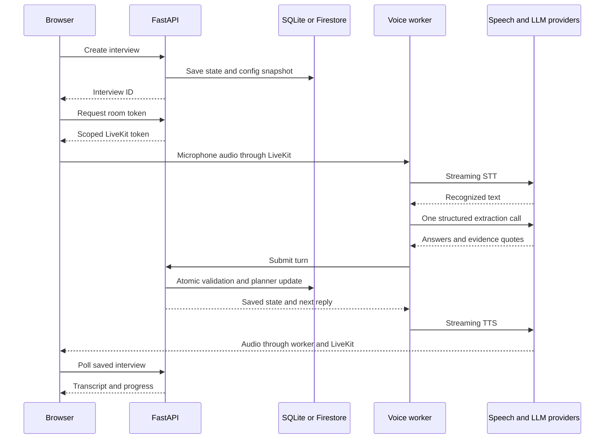
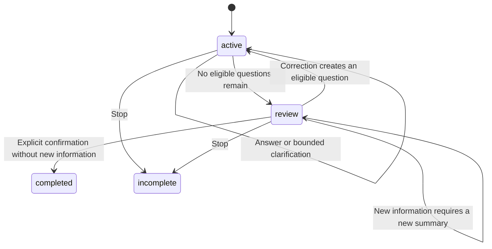

# Backend and voice code deep dive

The Python system has two running services. `app/` is the authoritative HTTP backend. `voice/` is a LiveKit worker that handles audio and calls that backend. Both import the same Pydantic models, but the worker must not write the database directly. This keeps transaction rules independent of speech providers.

## 1. Map the data flow first

STT means speech-to-text; TTS means text-to-speech. LiveKit transports media and manages the agent session. OpenAI interprets text. The planner chooses the question. The model is not given arbitrary database access.

## 2. First files: goals and models

Read [goals.py](../../app/goals.py), then [models.py](../../app/models.py).

`AnswerGoal` describes what to learn: a stable key, topic, question, sufficiency criteria, follow-up question, required/enabled flags, answer type and optional condition. `GoalAnswer` is a proposed answer for one turn. `GoalState` is the accumulated state including how many follow-ups have been used. Keeping these three separate prevents configuration from becoming confused with model output or stored progress.

Example: `funding_amount` is a number in EUR, applies only when `fundraising` equals `Ja`, and needs a quote from the current utterance. A value of zero is different from a missing number (`None`). A string saying “about a million” is not sufficient to establish a currency.

`default_goals()` constructs the initial catalogue. It defines 15 goals across seven topics, makes financing details conditional, and makes the financing timeline optional. Topic cards provide a broader summary; the smaller goals actually drive the conversation.

`validate_goal_config()` enforces cross-field rules. Conditions must point to an earlier choice goal and a valid choice. Earlier-only references prevent dependency cycles. Match rules must refer to goals of the right type. Reordering a prerequisite after its dependent goal may therefore fail validation even if every individual field looks valid.

`AgentConfig` adds agent name, tone, language, voice settings, guidance, topics and the match profile. `unique_topics()` also invokes goal validation. `Interview` is the persisted aggregate: config snapshot, owner, states, transcript, metrics, revision and processed request IDs. `Turn` bundles original recognized text with proposed extraction. `TranscriptItem` represents a displayed contribution; its text may reflect a spoken interruption.

`GoalExtraction` is the narrow schema sent to the model. `Extraction` also supports old topic-based fields for existing records. Do not conclude that those old fields are accepted by the current planner: it explicitly rejects them. `planner_version` defaults to 1 for old stored records; the new creation path explicitly selects 2.

### Python concepts to recognize

- `Literal[...]` restricts values when Pydantic validates them; a type annotation alone in ordinary Python does not enforce that restriction.
- `Field(default_factory=list)` creates a fresh list per instance. A shared mutable default would mix interview state.
- `model_validator(mode='after')` checks relationships after individual fields have been parsed.
- `model_dump()` produces data for serialization; `model_validate()` reconstructs and validates a model. These models forbid extra fields but do not globally enable Pydantic's strict type mode.
- `model_copy(update=...)` is not a substitute for validating arbitrary external changes. The code uses it for controlled internal updates.
- `AwareDatetime` prevents naive timestamps in incoming turns. Stored transcript timestamps are normalized by the API.

Run notebook 01 now. Interview question: “Why is a valid JSON response not necessarily a valid answer?” Answer: valid structure still needs evidence checks, typed values and semantic evaluation.

## 3. The deterministic planner

Read [planner.py](../../app/planner.py) in this order: `applicability`, `select_next`, `ask`, `create`, `advance`, `spoken_summary`, `sync_topics`.

`applicability()` returns three possible values. `True` means ask/evaluate the goal; `False` means the condition excludes it; `None` means the prerequisite is unresolved. Treating `None` as false would hide required questions and overstate completeness.

`select_next()` marks spent clarification budgets and picks an applicable unanswered goal, prioritizing required goals. `ask()` records the first question or increments the follow-up counter when asking again. `create()` initializes independent state and asks the first question.

`advance()` is the most important function. Trace it in phases:

1. Hash the serialized turn. If the ID was already processed with the same hash, return the current state. Reusing the ID with different content is a conflict.
2. Reject a closed interview, excessive turns or legacy extraction fields.
3. Validate all answers before changing state: goal existence, enabled flag, unique goal keys, exact quote occurrence, and compatible typed values.
4. Apply accepted answers. An isolated legal suffix cannot establish a full startup name or replace an existing name.
5. Add the original recognized user contribution to the transcript if not already present.
6. Handle interrupted questions and bounded clarification. Select a next question, enter review, or complete after explicit confirmation.
7. Update topic summaries, record the processed hash and increment the revision.

“Completed” means the summary was accepted, not that every answer was known. Exhausted questions remain partial or unknown. A founder can provide later corrections even after the planner has moved on.

`sync_topics()` projects goal state onto the seven topic cards. It is derived information, not an independent decision-maker. `spoken_summary()` limits each included value to 220 characters and reports unresolved required information; the full values remain in the report.

[interview.py](../../app/interview.py) is the entry facade. `create_interview()` selects the current planner; `apply_turn()` and `summary()` dispatch by planner version. Older topic-only logic exists for stored interviews and regression coverage. `stop_interview()` is idempotent for terminal states and does not turn a stopped conversation into a confirmed result.

Evidence limitation: checking that a quote occurs in a turn does not prove that the proposed value is supported by it. Combining earlier and current details also needs richer provenance than the current single evidence-turn reference. Discuss this as an improvement, not a solved guarantee.

## 4. Explainable scoring

Read [analysis.py](../../app/analysis.py). `analyze()` does not call an LLM and uses the interview's saved profile, not today's admin settings.

- Match = matched known weight / known weight × 100.
- Coverage = known weight / applicable-or-unresolved weight × 100.
- Completeness = answered relevant required goals / relevant required goals × 100.

A SaaS criterion of weight 3 matches, an MVP criterion of weight 1 is unknown: match 100, coverage 75. If stage later becomes a known mismatch: match 75, coverage 100. If no evidence is known, match is `None`, not zero. Explicitly inapplicable criteria are excluded; unresolved conditions remain a coverage gap. Numeric bounds are inclusive.

The function also sorts the transcript by timestamp, computes offsets and counts words and interruptions. Word share is not speaking time. Duration is wall-clock duration, including pauses. A live report uses the last contribution until the interview has ended.

Run notebook 02. Be able to calculate each denominator by hand.

## 5. Persistence and concurrency

Read [store.py](../../app/store.py), especially both `update()` methods. Storage uses a generic document envelope keyed by kind and ID; it is not a relational schema with a table for every domain object.

SQLite uses `BEGIN IMMEDIATE` to serialize read-modify-write transactions. The mutation callback receives the stored value and returns its replacement. An exception rolls the transaction back. This matters because transcript, answer and metric callbacks may arrive concurrently.

Firestore wraps the same pattern in its transaction mechanism. A transaction can retry its callback. Never make a TTS call, send a message or perform another external effect inside that callback. Those effects would not be rolled back and could happen more than once.

`check_size()` rejects serialized documents above 850,000 bytes in both backends. This keeps local behavior closer to deployed document limits. Growth is also bounded by turn and metric limits. It is still a single-document design; higher traffic or long sessions might call for separate append-only contributions and aggregates.

Idempotency is not identical to a transaction. A transaction prevents conflicting updates from overwriting one another; idempotency prevents a retried logical operation from being applied twice. The worker retries network/timeout failures with the same payload and IDs. A lost response after a committed write is exactly why this matters.

Run notebook 03 to observe duplicate handling, rollback and role claims without starting a server.

## 6. Settings and authorization

Read [config.py](../../app/config.py), [auth.py](../../app/auth.py) and [errors.py](../../app/errors.py).

`Settings` reads environment variables and `.env`; it is distinct from the editable `AgentConfig`. Secrets, provider selection and database paths are server settings. Voice choice and interview questions are agent settings. `missing_voice()` checks presence only, not API validity or worker availability.

Production validation requires separate long secrets, Firestore and an HTTPS origin. It does not by itself deploy TLS, configure IAM, or enforce network-level protection. Infrastructure must provide those layers.

`Auth.token()` creates an HS256-signed JWT with subject, role and expiration. A signature prevents tampering; it does not encrypt the claims. `Auth.read()` verifies the signature, expiration and expected roles. `user()` rejects an invitation token being used directly as a session. `admin()` adds role authorization. `worker()` uses a separate bearer secret and constant-time comparison.

Cookies are HttpOnly, SameSite Strict and Secure in production. This reduces specific browser risks; it is not a claim of complete CSRF/XSS protection. Invitation links last seven days and are exchangeable for a founder session. There is no one-time redemption or revocation database in the current implementation.

`ServiceError` carries a machine-readable code, safe human message, status and retryability flag. The frontend currently displays the message; it does not implement a general retry engine from the flag.

## 7. Read main.py by route group

[main.py](../../app/main.py) is the composition root. Do not read its routes before understanding the domain functions they call.

| Group | Functions to inspect | Key responsibility |
| --- | --- | --- |
| Construction | `create_app`, `migrate_config` | Select store, create auth, initialize/upgrade published config |
| Boundary | `boundary`, exception handlers | Request-origin/header checks, safe errors, response headers |
| Shared helpers | `config`, `load`, `mutate_interview` | Ownership and atomic model reconstruction |
| Identity | `bootstrap`, `login`, `logout`, `invite` | Demo/password/invitation paths and session cookies |
| Admin | `get_config`, `validate_config`, `publish`, `preview` | Draft validation, version conflicts, live voice preview |
| Founder | `history`, `start`, `detail`, `connection`, `stop` | Owned interview lifecycle |
| Simulation | `simulation` | Deterministic local test adapter, no speech or LLM |
| Reporting | `analysis`, `export` | Same persisted interview, derived result views |
| Internal | `worker_detail`, `worker_turn`, `worker_speech`, `worker_metrics`, `worker_stop` | Worker-authenticated callbacks |

`load()` returns 404 for both missing and inaccessible interviews, avoiding an existence leak. `mutate_interview()` rebuilds the model inside the transaction, applies the domain operation and serializes it.

Creation uses UUID5 over owner and request ID. Repeating the same request produces the same interview. A new browser start generates a new request ID. The server copies the currently published config into that interview. This is why configuration changes affect new conversations only.

Publication compares the submitted version with the current version before incrementing it. A stale editor receives 409. File import validates a draft and rebases its version; it does not publish. Config history retains up to 100 older versions, but there is no version-browser UI.

Synchronous `def` endpoints can use synchronous storage without placing that work directly on the async event loop. Async endpoints explicitly offload storage through `run_in_threadpool` before awaiting provider calls. Using `async def` alone does not make blocking work asynchronous.

`worker_speech()` upserts by contribution ID and preserves chronology. Spoken assistant text is saved separately from the planned reply, because interruptions can truncate what was heard. Its interrupted-question detection is a textual heuristic, not perfect acoustic proof. Metrics are deduplicated by ID and limited to the latest 300 entries.

## 8. Provider boundary and voice pipeline

Read [providers.py](../../app/providers.py), then [stt.py](../../voice/stt.py), [extraction.py](../../voice/extraction.py), [worker.py](../../voice/worker.py).

`room_access()` issues a five-minute, room-scoped LiveKit token for the owner, permitting microphone publication and subscription. The room configuration dispatches the named worker with interview metadata. `close_room()` is best effort; the browser stops capture independently and the watchdog checks saved status.

`voice_preview()` is a short REST TTS request. It translates known ElevenLabs error formats into safe messages. It is not identical to the worker's streaming TTS path, so a successful preview does not validate streaming or end-to-end latency. Neither a voice dropdown entry nor a valid Voice-ID proves account entitlement.

`create_stt()` is a factory returning LiveKit's shared `stt.STT` interface. Deepgram Nova-3 and ElevenLabs Scribe v2 Realtime already adapt their wire protocols; a redundant wrapper is unnecessary. Provider selection is server-wide. ElevenLabs can use a separate STT key, while TTS still uses its own configured key. There is no silent fallback that changes cost or sends data to another provider.

`Extractor.extract()` sends current text, prior goal answers and configured criteria to one forced structured tool call. Pydantic supplies the tool schema. The timeout is seven seconds with automatic retries disabled. The response must contain exactly one tool call. The backend then checks the result again. The model does not directly invoke Python functions or write storage: our code interprets the returned tool arguments.

The worker's `Interviewer.llm_node()` is an async generator: it can await extraction and saving, then yield the canonical reply into LiveKit's TTS pipeline. `ControllerModel` exists to satisfy the pipeline lifecycle; its normal `chat()` path should not run. There is no second LLM generation to phrase the next question, and the structured extraction response itself is not token-streamed.

`entrypoint()` validates room identity, loads the interview, creates providers and starts the session. Prewarming loads Silero VAD and the local end-of-turn model. Turn detection, interruption thresholds and endpointing delays work together; none alone solves every pause or barge-in case. The name question has at least 1.2 seconds of endpointing delay. Other questions use configured pauses.

Callbacks record actual speech and metrics. Background tasks are retained so shutdown can await them. The watchdog polls every two seconds, checks duration and terminal state, and closes the session. Repeated extraction/backend failures stop the interview after two consecutive failures; the first retry phrase rotates without an additional LLM call. This wording improvement does not fix the underlying failure.

## 9. What you can and cannot claim

| Claim | Accurate explanation |
| --- | --- |
| Streaming | Audio/STT stream; structured LLM extraction waits for a complete response |
| Natural conversation | Interruptions and bounded follow-ups exist; arbitrary counterquestions are not fully handled |
| Evidence grounding | Exact quote checks and typed validation; semantic grounding remains imperfect |
| Low latency | Designed to avoid duplicate model calls; worker latency proxy is not browser p95 |
| History | Saved transcripts/results, not raw app audio recordings |
| Security | Server-side checks and scoped tokens; production infrastructure still requires validation |
| Provider portability | STT factory shares an SDK interface; changing providers still needs live quality testing |

## 10. Tests and deployment reading

Read `tests/test_goals.py`, `test_extraction.py`, `test_stt.py`, `test_voice.py`, `test_api.py` alongside the corresponding modules. The tests prove specific examples and contracts, not all model behavior. `scripts/voice_check.py --live` uses real providers and may consume credits. Its per-provider `ok` fields matter; it is not a full interview test.

`pyproject.toml` defines package dependencies and optional voice/test groups. `requirements-lock.txt` records resolved packages, but the Dockerfiles install from project dependency declarations rather than that lock file. Do not claim completely pinned container builds.

The API Dockerfile builds the frontend in Node and copies the static output into Python. The worker Dockerfile installs voice extras and downloads local models. Compose starts the API and an optional voice worker; Firestore deployment configuration is separate. `__init__.py` files mark package boundaries and contain no application flow to memorize.

## Interview practice

Explain why deterministic code owns transactions, why a snapshot matters, why idempotency keys are necessary, and how quote validation differs from truth. Then propose improvements: typed operational error metrics, stronger evidence provenance, a dedicated counterquestion path, explicit name confirmation, provider comparison tests and measured browser latency. Present these as future work, not features already delivered.
