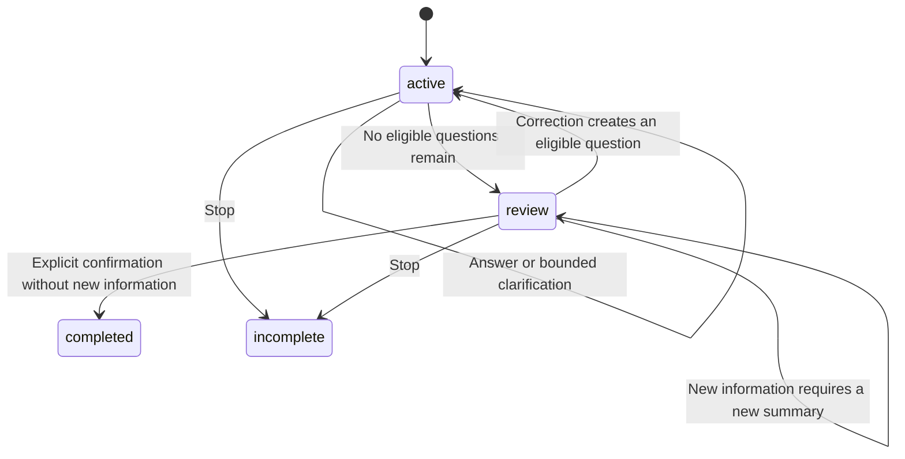

# Backend and voice code deep dive

The Python system has two running services. `app/` is the authoritative HTTP backend. `voice/` is a LiveKit worker that handles audio and calls that backend. Both import the same Pydantic models, but the worker must not write the database directly. This keeps transaction rules independent of speech providers.

## 1. Map the data flow first

The detailed sequence below follows a real **voice interview**, from opening the frontend to reopening its saved report. It shows one loop for all answer goals, including follow-ups and summary corrections. The participants are logical responsibilities: the planner and analysis functions run inside the API process, not in separate services.

The diagram uses German labels to support the interview presentation. Participant labels are repeated as notes at the start of each of the five phases, so the full sequence stays in one diagram while remaining navigable when zoomed in. Download the editable [Mermaid source](diagrams/12-interview-full-sequence.mmd) to render it separately or use it for slides. The optional admin configuration phase is a prerequisite: the administrator publishes settings before the founder starts; each interview saves its own snapshot.

```mermaid
sequenceDiagram
    autonumber
    actor U as Startup / Gründer
    participant F as React-Frontend / Browser
    participant A as FastAPI / Auth
    participant P as Interview / Planner / Analysis
    participant D as SQLite / Firestore
    participant L as LiveKit-Raum / WebRTC
    participant W as Python Voice-Worker
    participant S as Deepgram / ElevenLabs STT
    participant M as OpenAI / Extractor
    participant T as ElevenLabs TTS

    Note over U,D: 1. Einstieg und Anmeldung — veröffentlichte Admin-Konfiguration existiert
    Note over U: Startup / Gründer
    Note over F: React-Frontend / Browser
    Note over A: FastAPI / Auth
    Note over P: Interview / Planner / Analysis
    Note over D: SQLite / Firestore
    Note over L: LiveKit-Raum / WebRTC
    Note over W: Python Voice-Worker
    Note over S: Deepgram / ElevenLabs STT
    Note over M: OpenAI / Extractor
    Note over T: ElevenLabs TTS
    U->>F: Seite öffnen (optional mit Einladungslink)
    F->>A: GET /api/bootstrap
    A->>D: Veröffentlichte Konfiguration lesen
    D-->>A: Agentname, Sprache, Fragen, Stimme, Version
    A-->>F: Sitzungsrolle, Agentinfos, voice_ready
    Note over F,A: voice_ready prüft vorhandene Einstellungen, keinen Live-Zugang zum Anbieter
    opt Noch keine gültige Sitzung
        U->>F: Einladung einlösen / lokalen Startup-Zugang wählen
        F->>A: POST /api/login
        A->>A: Einladung oder erlaubten lokalen Zugang prüfen
        A-->>F: Rolle und HttpOnly-Sitzungscookie
        F->>A: GET /api/bootstrap
        A-->>F: Angemeldeter Zustand
    end
    F->>A: GET /api/interviews
    A->>D: Eigene Interviews laden (Admin darf alle sehen)
    D-->>A: Interviewdaten
    A-->>F: Historie mit Zeitstempeln und Status
    Note over F,A: Menü Gesprächsverlauf nur für Admins sichtbar, API-Besitzerprüfung bleibt bestehen

    opt Freiwilliger Mikrofontest vor dem Interview
        U->>F: Mikrofon testen
        F->>F: getUserMedia / Browserberechtigung
        F->>F: AudioContext / AnalyserNode zeigt Eingangspegel
        Note over F: Nur lokal, keine Aufnahme oder Übertragung an Anbieter
        F->>F: Bei Stopp / Timeout / Navigation Tracks und AudioContext schließen
    end

    Note over U,W: 2. Interview anlegen, verbinden und erste Frage sprechen
    Note over U: Startup / Gründer
    Note over F: React-Frontend / Browser
    Note over A: FastAPI / Auth
    Note over P: Interview / Planner / Analysis
    Note over D: SQLite / Firestore
    Note over L: LiveKit-Raum / WebRTC
    Note over W: Python Voice-Worker
    Note over S: Deepgram / ElevenLabs STT
    Note over M: OpenAI / Extractor
    Note over T: ElevenLabs TTS
    U->>F: Interview starten
    F->>A: POST /api/interviews (voice, eindeutige request_id)
    A->>A: Sitzung und Voice-Konfiguration prüfen
    A->>D: Aktuelle veröffentlichte Konfiguration lesen
    D-->>A: AgentConfig mit Antwortzielen und Match-Profil
    A->>D: Atomare Erstellung beginnen / vorhandene request_id prüfen
    D-->>A: Existierendes Interview oder leerer Zustand
    opt Neue request_id
        A->>P: create_interview → create(owner, config, voice)
        P->>P: GoalStates initialisieren, select_next, ask
        P-->>A: Interview mit Ablaufhinweisen, Korrekturoptionen, erster Frage und Config-Snapshot
    end
    A->>D: Interview speichern / Transaktion abschließen
    D-->>A: Gespeicherter Zustand
    A-->>F: Interview mit ID und last_reply
    F->>A: POST /api/interviews/{id}/connection
    A->>D: Interview laden
    D-->>A: Besitzer, Modus und Status
    A->>A: Zugriff prüfen und kurzlebiges Raumtoken signieren
    A-->>F: LiveKit-URL und Token mit Worker-Dispatch-Metadaten
    F->>L: Room.connect(URL, Token)
    L->>W: Job für founder-interviewer mit interview_id zuweisen
    Note over L,W: Browser und Worker verbinden sich asynchron, nicht strikt nacheinander
    W->>A: GET /api/internal/interviews/{id} mit Worker-Secret
    A->>D: Interview laden
    D-->>A: Gespeicherter Zustand und Konfiguration
    A-->>W: Interview
    W->>W: Raum-ID und Status prüfen, STT-Factory, Extractor und TTS konfigurieren
    Note over W,S: STT erhält Fachbegriffe wie MVP, SaaS und GmbH als Erkennungshinweise, keine Garantie
    Note over W: Lokale VAD-/Turn-Detection-Modelle wurden im Prozess vorgewärmt
    F->>F: startAudio, setMicrophoneEnabled(true)
    F->>L: Mikrofontrack veröffentlichen
    W->>L: ctx.connect und auf Founder-Teilnehmer warten
    W->>W: AgentSession.start / on_enter
    L-->>F: Agent verbunden, Remote-Audiotrack abonnieren
    F->>F: Audiotrack an Wiedergabe anhängen, Agent-bereit anzeigen
    Note over F,L: Kein Agent nach 30 s → Verbindung schließen und Interview stoppen
    W->>T: session.say: Einführung und Ankündigung der ersten Frage
    T-->>W: Gestreamte Audioabschnitte
    W-->>L: Agent-Audio veröffentlichen
    L-->>F: Remote-Audio über WebRTC
    F-->>U: Einführung und Ankündigung hörbar
    W->>W: Wiedergabe abwarten, dann 0,8 s Pause
    opt Nicht unterbrochen, Revision unverändert, active und Founder spricht nicht
        W->>T: session.say(current_prompt): erste Frage
        T-->>W: Frage als Audiostream
        W-->>L: Agent-Audio
        L-->>F: Remote-Audio
        F-->>U: Erste Frage hörbar
    end
    W->>A: POST /api/internal/interviews/{id}/speech
    A->>D: Session-Transkriptbeitrag nach ID speichern
    D-->>A: Gespeichert
    A-->>W: Kanonischer Zustand

    Note over U,T: 3. Eine Schleife für alle Antworten, Rückfragen und die Abschlussprüfung
    Note over U: Startup / Gründer
    Note over F: React-Frontend / Browser
    Note over A: FastAPI / Auth
    Note over P: Interview / Planner / Analysis
    Note over D: SQLite / Firestore
    Note over L: LiveKit-Raum / WebRTC
    Note over W: Python Voice-Worker
    Note over S: Deepgram / ElevenLabs STT
    Note over M: OpenAI / Extractor
    Note over T: ElevenLabs TTS
    par Sprachdialog
        loop Solange das Interview aktiv oder in review ist
            U->>F: Antwort sprechen / Gegenfrage / Korrektur / Bestätigung
            F->>L: Mikrofon-Audiostream
            L->>W: Audio des Founders
            W->>S: Streaming-Spracherkennung
            S-->>W: Vorläufiger und finaler erkannter Text
            W-->>L: Live-Transkriptionsereignisse über die Session
            L-->>F: TranscriptionReceived: vorläufigen Text anzeigen
            W->>W: VAD, Turn Detector und Pausenregel erkennen Sprechende
            Note over W: Beim Startup-Namen mindestens 1,2 s Pause, sonst konfigurierte Pause
            opt Founder unterbricht laufende Agent-Ausgabe
                W->>W: LiveKit unterbricht die Sprachausgabe
                W->>A: POST /speech (gesprochener Text, interrupted=true)
                A->>D: Beitrag speichern, ggf. interrupted_question vormerken
                A-->>W: Aktualisierter Interviewstand
            end
            W->>W: on_user_turn_completed / llm_node: turn_id und Text übernehmen
            W->>M: extract(Text, Zustand): Ziele, Kriterien, bisherige Antworten, Tonalität
            Note over W,M: Genau ein strukturierter Aufruf, keine Token-Streaming-Antwort
            M-->>W: Extraction: answers, Belegzitate, acknowledgment, dialogue_act, confirmed_summary
            Note over M: KI bewertet Vollständigkeit nach Kriterien, vage oder unbelegte Angaben sollen partial bleiben
            Note over M: value sprachlich glätten, quote unverändert, Zahlen und Unsicherheiten bewahren
            Note over M,P: Belegprüfung sichert Textvorkommen, keine unabhängige semantische Richtigkeit
            W->>W: Pydantic prüft die Struktur des Tool-Ergebnisses
            W->>A: POST /api/internal/interviews/{id}/turns (Turn)
            A->>A: Worker authentifizieren und Eingabe validieren
            A->>A: mutate_interview(id, Callback)
            A->>D: store.update: atomare Änderung beginnen, aktuellen Interviewstand lesen
            D-->>A: Aktueller Zustand
            A->>P: apply_turn → advance(interview, turn)
            P->>P: ID / Inhalt, Status, Turn-Limit und alle Belege prüfen
            Note over P: Identische Wiederholung ist wirkungslos, anderer Inhalt zur selben ID ist Konflikt
            P->>P: Antworten und Korrekturen übernehmen, Nutzertranskript ergänzen
            P->>P: Dialogabsicht, aktuelle Frage und Anwendbarkeit prüfen
            alt Review mit Wiederholungswunsch oder Frage
                P->>P: Vollständige Zusammenfassung wiederholen oder fehlende Pflichtziele benennen
                Note over P: Kein Abschluss durch eine Frage, bei repeat auch offene Angaben mit vorlesen
            else Nur andere Antwortziele ergänzt oder korrigiert
                P->>P: Aktuelle Frage erhalten und wiederholen, Budget unverändert
            else Wiederholung oder Erklärung der offenen Frage gewünscht
                P->>P: Frage wiederholen oder anhand der Kriterien erklären, Budget unverändert
            else Unterbrochene Frage muss wiederholt werden
                P->>P: Frage wiederholen, kein zusätzliches Rückfragebudget verbrauchen
            else Relevantes Antwortziel noch offen
                P->>P: select_next und ask: erste Frage oder konfigurierte Rückfrage wählen
                Note over P: Mehrere erlaubte Rückfragen verwenden denselben konfigurierten Text
                Note over P: Pflichtziele zuerst, geklärte Ziele überspringen, Rückfragen begrenzen
            else Kein Ziel offen, aber noch keine reine Bestätigung
                P->>P: status=review, Übergang zur Zusammenfassung, spoken_summary und Bestätigungsfrage
                Note over P: Nach Korrektur erneut vollständige Zusammenfassung mit kurzem Aktualisierungshinweis
                Note over P: Neue Antworten/Korrekturen verhindern gleichzeitigen Abschluss
            else In review ausdrücklich bestätigt, ohne neue Antworten
                P->>P: status=completed, ended_at setzen, Abschlusstext wählen
            end
            P->>P: Themenübersicht, verarbeitete Turn-ID und Revision aktualisieren
            P-->>A: Aktualisiertes Interview mit last_reply
            A->>D: Änderungen atomar speichern
            D-->>A: Commit erfolgreich
            A-->>W: Kanonisch gespeichertes Interview
            W->>W: Eigenen Zustand ersetzen, last_reply an TTS weitergeben
            W->>T: Nächste Frage / Rückfrage / Zusammenfassung / Abschluss
            alt TTS liefert Audio
                T-->>W: Audio streamen
            else TTS scheitert, z.B. Kontingent aufgebraucht
                T-->>W: Anbieterfehler oder keine Audioframes
                Note over W,F: Aktuelle Grenze: keine verlässliche verständliche TTS-Fehlermeldung im Frontend
                Note over W,A: Session kann Text ohne Audio liefern, Transkripteintrag beweist keine hörbare Ausgabe
            end
            W-->>L: Agent-Audio
            L-->>F: Audio und Sprecherstatus
            F-->>U: Antwort bei erfolgreicher Audioausgabe hörbar, Sprechstatus sichtbar
            W->>A: POST /speech für Session-Transkript der Agent-Ausgabe
            A->>D: Transkript nach ID aktualisieren, Zeitstempel erhalten
            A-->>W: Gespeicherter Zustand
            Note over W,A: Hintergrundcallbacks melden außerdem /metrics: LLM, STT, TTS, Latenz, Fehler
        end
    and Sichtbarer gespeicherter Verlauf
        loop Alle 1,5 s, solange die Frontend-Verbindung nicht idle ist
            F->>A: GET /api/interviews/{id}
            A->>A: Sitzungsrolle und Besitzer prüfen
            A->>D: Interview laden
            D-->>A: Transkript, Antworten, Status und Fortschritt
            A-->>F: Interview
            F->>F: React-State aktualisieren, Verlauf und Fortschritt anzeigen
        end
    and Laufzeitüberwachung
        loop Worker-Watchdog alle 2 s
            W->>A: GET /api/internal/interviews/{id}
            A->>D: Aktuellen Status lesen
            D-->>A: Interview
            A-->>W: Status
            W->>W: completed / incomplete / konfigurierte Maximaldauer prüfen
        end
    end

    Note over U,D: 4. Abschluss oder vorzeitiges Beenden
    Note over U: Startup / Gründer
    Note over F: React-Frontend / Browser
    Note over A: FastAPI / Auth
    Note over P: Interview / Planner / Analysis
    Note over D: SQLite / Firestore
    Note over L: LiveKit-Raum / WebRTC
    Note over W: Python Voice-Worker
    Note over S: Deepgram / ElevenLabs STT
    Note over M: OpenAI / Extractor
    Note over T: ElevenLabs TTS
    alt Regulär bestätigt und gespeichert
        Note over A,D: completed und ended_at wurden bereits in der Turn-Transaktion gespeichert
        W->>W: Watchdog erkennt completed, wartet 5 s für Abschlussaudio
        W->>W: Session schließen
        W->>A: POST /api/internal/interviews/{id}/stop
        A->>P: stop_interview: completed bleibt completed
        A->>D: Zustand speichern
        A-->>W: Interview
    else Startup klickt Gespräch beenden
        U->>F: Stopp
        F->>F: Mikrofontracks sofort stoppen
        F->>L: Raumverbindung trennen
        F->>A: POST /api/interviews/{id}/stop
        A->>D: Interview und Berechtigung prüfen
        A->>P: stop_interview: active/review → incomplete, ended_at setzen
        A->>D: Antworten und Transkript erhalten, Status speichern
        A->>L: Raum löschen (begrenzte Wartezeit)
        A-->>F: Gespeichertes Interview
        W->>W: Watchdog / Shutdown schließt Session
    else Zeitlimit oder Verbindungs-/Verarbeitungsfehler
        Note over W: Bei Zeitlimit Session schließen und /stop aufrufen
        Note over W,A: Bei zwei aufeinanderfolgenden Verarbeitungsfehlern /stop versuchen
        Note over F,A: Unerwartete Raumtrennung löst auch im Frontend /stop aus
        Note over A,D: Erfolgreicher Stop setzt nur aktive/review Interviews auf incomplete
    end
    W->>W: Shutdown: Session schließen, ausstehende Speicheraufgaben abwarten
    W->>A: Abschließender idempotenter POST /api/internal/interviews/{id}/stop
    A->>D: Endzustand speichern
    A-->>W: Interview
    W->>W: Backend- und OpenAI-Client schließen
    L-->>F: Disconnected (falls nicht bereits getrennt)
    F->>F: Audioelemente entfernen, Verbindung idle, Live-Text leeren
    Note over F,A: Bei unerwarteter Trennung lädt der /stop-Rückgabewert den Endzustand nach

    Note over U,D: 5. Ergebnis, Transkript, Export und spätere Historie
    Note over U: Startup / Gründer
    Note over F: React-Frontend / Browser
    Note over A: FastAPI / Auth
    Note over P: Interview / Planner / Analysis
    Note over D: SQLite / Firestore
    Note over L: LiveKit-Raum / WebRTC
    Note over W: Python Voice-Worker
    Note over S: Deepgram / ElevenLabs STT
    Note over M: OpenAI / Extractor
    Note over T: ElevenLabs TTS
    U->>F: Auswertung und Transkript öffnen
    F->>A: GET /api/interviews/{id}/analysis
    A->>D: Interview mit ursprünglichem Config-Snapshot laden
    D-->>A: Gespeicherte Antworten und Transkript
    A->>P: analyze(interview)
    P->>P: Vollständigkeit aus answered-Pflichtzielen berechnen
    P->>P: Match-Regeln deterministisch prüfen: Kategorie in accepted oder Zahl im Bereich
    Note over P: Freitext wie Team oder Traktion wird nicht direkt auf Match bewertet
    P->>P: Match aus bekannten Gewichten, Coverage aus bekannten zu relevanten Gewichten
    Note over P: Unbekannt ist kein negativer Match, ohne konfigurierte Regeln kein Match-Score
    P->>P: Themenfortschritt und Statistiken berechnen
    P-->>A: AnalysisReport mit Belegen und chronologischem Transkript
    A-->>F: Bericht (kein zusätzlicher KI-Aufruf)
    F-->>U: Kennzahlen, Grafiken, Antworten und durchsuchbares Transkript
    opt Ergebnis herunterladen
        F->>A: GET /api/interviews/{id}/export
        A->>D: Autorisiertes Interview laden
        A->>P: summary und analyze
        A-->>F: Strukturierte Ergebnisdaten
        F-->>U: JSON-Datei herunterladen
    end
    opt Admin öffnet ein Gespräch später erneut über die Historie
        U->>F: Gesprächsverlauf öffnen
        F->>A: GET /api/interviews
        A->>D: Sichtbare Interviews nach Besitzer laden
        A-->>F: Historie mit Zeitstempeln
        U->>F: Ein Gespräch auswählen
        F->>A: GET /api/interviews/{id}
        A-->>F: Gespeichertes Interview
        F->>A: GET /api/interviews/{id}/analysis
        A-->>F: Erneut aus dem Snapshot berechneter Bericht
    end
```

### How to read the parallel paths

- **Audio:** Browser → LiveKit → worker → STT, then worker → TTS → LiveKit → browser. FastAPI does not carry the microphone or playback stream.
- **State:** The worker submits the recognized text and extracted answers to FastAPI. The API loads the current state inside a storage transaction, invokes the planner, and commits before returning the reply that the worker may speak.
- **Display:** Interim recognition comes through LiveKit events. The durable conversation, answers, and status come from the frontend's 1.5-second HTTP polling. The text display can therefore lag behind speech.
- **Completion:** A summary confirmation is another turn through the same loop. Corrections require another review or further questions. Stopping capture alone marks an unfinished interview as `incomplete`.

### Timing and failure details

The `par` branches represent concurrent activities, not synchronized barriers. Watchdog, transcript callbacks, browser polling, and disconnect events may overlap. The diagram groups them for readability; exact event arrival order is not guaranteed. The worker schedules speech persistence in the background and drains outstanding tasks on shutdown.

The 30-second frontend timer waits for the agent to join the room; it is **not** an answer timeout. The extractor uses a 7-second timeout with no automatic model retries. Worker-to-backend requests have an 8-second timeout and retry once after a network error or timeout with the same payload. If extraction or turn processing fails, the worker attempts to retain the user transcript and speaks a rotating retry phrase; after repeated failures, it offers another attempt or a manual stop without automatically ending the interview. The current question and clarification budget remain unchanged for rejected turns. After an uncertain write, it reads the backend state and checks the processed turn ID before announcing success. If the backend is unreachable, it cannot guarantee that the final status was persisted. These failure messages bypass normal question selection and do not claim a successful write.

The five-second wait on confirmed completion gives closing audio time to finish; it does not verify that the browser played the entire closing message. Silence by itself is not treated as an answer or confirmation. The configured maximum interview duration limits the session; there is no separate scripted “Are you still there?” silence timer.

### Source pointers by phase

| Phase | Frontend | Backend / worker |
| --- | --- | --- |
| Bootstrap, login, history | [App.tsx](../../frontend/src/App.tsx): `refresh`, `login`, effects | [main.py](../../app/main.py): `bootstrap`, `login`, `history`; [auth.py](../../app/auth.py) |
| Local microphone test | [MicrophoneTest.tsx](../../frontend/src/MicrophoneTest.tsx) | No backend or provider request |
| Create and connect | [App.tsx](../../frontend/src/App.tsx): `start`, room event handlers | [main.py](../../app/main.py): `start`, `connection`; [providers.py](../../app/providers.py): `room_access`; [worker.py](../../voice/worker.py): `entrypoint`, `on_enter` |
| Recognize and interpret | LiveKit microphone track and interim transcription handler | [stt.py](../../voice/stt.py): `create_stt`; [worker.py](../../voice/worker.py): `endpointing_delay`, `llm_node`; [extraction.py](../../voice/extraction.py): `extract` |
| Process one answer | Saved state displayed by polling | [main.py](../../app/main.py): `worker_turn`, `mutate_interview`; [interview.py](../../app/interview.py): `apply_turn`; [planner.py](../../app/planner.py): `advance`, `applicability`, `select_next`, `ask`, `spoken_summary`; [store.py](../../app/store.py): `update` |
| Speech and evidence | Audio track attachment, speaker status, transcript UI | [worker.py](../../voice/worker.py): `conversation`, `spoken_message`, metric callbacks; [main.py](../../app/main.py): `worker_speech`, `worker_metrics` |
| Stop and cleanup | [App.tsx](../../frontend/src/App.tsx): `stop`, disconnected handler | [worker.py](../../voice/worker.py): `watchdog`, `shutdown`; [main.py](../../app/main.py): `stop`, `worker_stop`; [interview.py](../../app/interview.py): `stop_interview` |
| Report and export | [InterviewReport.tsx](../../frontend/src/InterviewReport.tsx), [App.tsx](../../frontend/src/App.tsx): `exportResult` | [main.py](../../app/main.py): `analysis`, `export`; [analysis.py](../../app/analysis.py): `analyze` |

STT means speech-to-text; TTS means text-to-speech. The local text simulation skips LiveKit, STT, the LLM, and TTS: `sendSimulation()` submits explicit answer classifications to `/simulation-turn`, which invokes the same planner and storage transaction.

## 2. First files: goals and models

Read [goals.py](../../app/goals.py), then [models.py](../../app/models.py).

`AnswerGoal` describes what to learn: a stable key, topic, question, sufficiency criteria, follow-up question, required/enabled flags, answer type and optional condition. `GoalAnswer` is a proposed answer for one turn. `GoalState` is the accumulated state including how many follow-ups have been used. Keeping these three separate prevents configuration from becoming confused with model output or stored progress.

Example: `funding_amount` is a number in EUR, applies only when `fundraising` equals `Ja`, and needs a quote from the current utterance. A value of zero is different from a missing number (`None`). A string saying “about a million” is not sufficient to establish a currency.

`default_goals()` constructs the initial catalogue. It defines 15 goals across seven topics, makes financing details conditional, and makes the financing timeline optional. Topic cards provide a broader summary; the smaller goals actually drive the conversation.

`validate_goal_config()` enforces cross-field rules. Conditions must point to an earlier choice goal and a valid choice. Earlier-only references prevent dependency cycles. Match rules must refer to goals of the right type. Reordering a prerequisite after its dependent goal may therefore fail validation even if every individual field looks valid.

`AgentConfig` adds agent name, tone, language, voice settings, guidance, topics and the match profile. `unique_topics()` also invokes goal validation. `Interview` is the persisted aggregate: config snapshot, owner, states, transcript, metrics, revision and processed request IDs. `Turn` bundles original recognized text with proposed extraction. `TranscriptItem` represents a displayed contribution; its text may reflect a spoken interruption.

`Extraction` is the single schema shared by the model-facing tool and incoming turns: `answers`, `acknowledgment`, and `confirmed_summary`. Topics contain only a key and title; their displayed state is derived from goals. There is one controller for every interview, with no planner-version switch.

### Python concepts to recognize

- Function signatures now name their input and output types. For example, `applicability(interview: Interview, goal: AnswerGoal) -> bool | None` receives a complete interview and one goal definition, and returns `True`, `False`, or `None`. Interview variables previously called `item` are now called `interview`.
- `-> None` means a function returns no result; it may still modify the interview. `-> Interview` means the result is an interview, but does not imply that a new copy was created.
- `Self` in a model validator means it returns the same model type. `Callable[[Interview], Interview]` describes a callback that receives and returns an interview. Async function annotations describe the result obtained after `await`; `AsyncIterator[str]` describes streamed text yielded by the worker.
- [types.py](../../app/types.py) contains shared aliases: `TopicKey`, `InterviewMode`, and `Document`. `Document` is a heterogeneous dictionary used at storage/HTTP boundaries; its values intentionally use `Any`. It provides less static checking than a domain model, so incoming data still needs Pydantic validation.
- `AnalysisReport` in [analysis.py](../../app/analysis.py) is a `TypedDict`: it describes a normal dictionary's keys and value types for the editor and type checker, without creating a new runtime report object. `InterviewBackend` and `AnswerExtractor` in [worker.py](../../voice/worker.py) are `Protocol` interfaces: real services and test doubles satisfy them by exposing the required methods.
- `cast(...)` tells the type checker an already-established type; it does not convert or validate a value. `from __future__ import annotations` postpones annotation evaluation, allowing forward references. Neither annotation feature replaces runtime validation.
- `Literal[...]` restricts values when Pydantic validates them; a type annotation alone in ordinary Python does not enforce that restriction.
- `Field(default_factory=list)` creates a fresh list per instance. A shared mutable default would mix interview state.
- `model_validator(mode='after')` checks relationships after individual fields have been parsed.
- `model_dump()` produces data for serialization; `model_validate()` reconstructs and validates a model. These models forbid extra fields but do not globally enable Pydantic's strict type mode.
- `model_copy(update=...)` is not a substitute for validating arbitrary external changes. The code uses it for controlled internal updates.
- `AwareDatetime` prevents naive timestamps in incoming turns. Stored transcript timestamps are normalized by the API.

Run notebook 01 now. Interview question: “Why is a valid JSON response not necessarily a valid answer?” Answer: valid structure still needs evidence checks, typed values and semantic evaluation.

## 3. The deterministic planner

First read [interview.py](../../app/interview.py): `create_interview`, `apply_turn`, and `summary` delegate directly to the planner; `stop_interview` marks unfinished conversations as incomplete. Then read [planner.py](../../app/planner.py) in this order: `applicability`, `select_next`, `ask`, `create`, `advance`, `spoken_summary`, `sync_topics`.

`applicability()` returns three possible values. `True` means ask/evaluate the goal; `False` means the condition excludes it; `None` means the prerequisite is unresolved. Treating `None` as false would hide required questions and overstate completeness.

`select_next()` marks spent clarification budgets and picks an applicable unanswered goal, prioritizing required goals. `ask()` records the first question or increments the follow-up counter when asking again. `create()` initializes independent state and asks the first question.

`advance()` is the most important function. Trace it in phases:

1. Hash the serialized turn. If the ID was already processed with the same hash, return the current state. Reusing the ID with different content is a conflict.
2. Reject a closed interview or excessive turns. Unexpected extraction fields are already rejected by Pydantic.
3. Validate all answers before changing state: goal existence, enabled flag, unique goal keys, exact quote occurrence, and compatible typed values.
4. Apply accepted answers. An isolated legal suffix cannot establish a full startup name or replace an existing name.
5. Add the original recognized user contribution to the transcript if not already present.
6. Handle interrupted questions and bounded clarification. Select a next question, enter review, or complete after explicit confirmation.
7. Update topic summaries, record the processed hash and increment the revision.



“Completed” means the summary was accepted, not that every answer was known. Exhausted questions remain partial or unknown. A founder can provide later corrections even after the planner has moved on.

`sync_topics()` projects goal state onto the seven topic cards. It is derived information, not an independent decision-maker. `spoken_summary()` limits each included value to 220 characters and reports unresolved required information; the full values remain in the report.

[interview.py](../../app/interview.py) is the entry facade. `create_interview()` selects the current planner; `apply_turn()` and `summary()` dispatch by planner version. Older topic-only logic exists for stored interviews and regression coverage. `stop_interview()` is idempotent for terminal states and does not turn a stopped conversation into a confirmed result.

Evidence limitation: checking that a quote occurs in a turn does not prove that the proposed value is supported by it. Combining earlier and current details also needs richer provenance than the current single evidence-turn reference. Discuss this as an improvement, not a solved guarantee.

## 4. Explainable scoring

Read [analysis.py](../../app/analysis.py). `analyze()` does not call an LLM and uses the interview's saved profile, not today's admin settings.

- Match = matched known weight / known weight × 100.
- Coverage = known weight / applicable-or-unresolved weight × 100.
- Completeness = answered relevant required goals / relevant required goals × 100.

A SaaS criterion of weight 3 matches, an MVP criterion of weight 1 is unknown: match 100, coverage 75. If stage later becomes a known mismatch: match 75, coverage 100. If no evidence is known, match is `None`, not zero. Explicitly inapplicable criteria are excluded; unresolved conditions remain a coverage gap. Numeric bounds are inclusive.

The function also sorts the transcript by timestamp, computes offsets and counts words and interruptions. Word share is not speaking time. Duration is wall-clock duration, including pauses. A live report uses the last contribution until the interview has ended.

Run notebook 02. Be able to calculate each denominator by hand.

## 5. Persistence and concurrency

Read [store.py](../../app/store.py), especially both `update()` methods. Storage uses a generic document envelope keyed by kind and ID; it is not a relational schema with a table for every domain object.

SQLite uses `BEGIN IMMEDIATE` to serialize read-modify-write transactions. The mutation callback receives the stored value and returns its replacement. An exception rolls the transaction back. This matters because transcript, answer and metric callbacks may arrive concurrently.

Firestore wraps the same pattern in its transaction mechanism. A transaction can retry its callback. Never make a TTS call, send a message or perform another external effect inside that callback. Those effects would not be rolled back and could happen more than once.

`check_size()` rejects serialized documents above 850,000 bytes in both backends. This keeps local behavior closer to deployed document limits. Growth is also bounded by turn and metric limits. It is still a single-document design; higher traffic or long sessions might call for separate append-only contributions and aggregates.

Idempotency is not identical to a transaction. A transaction prevents conflicting updates from overwriting one another; idempotency prevents a retried logical operation from being applied twice. The worker retries network/timeout failures with the same payload and IDs. A lost response after a committed write is exactly why this matters.

Run notebook 03 to observe duplicate handling, rollback and role claims without starting a server.

## 6. Settings and authorization

Read [config.py](../../app/config.py), [auth.py](../../app/auth.py) and [errors.py](../../app/errors.py).

`Settings` reads environment variables and `.env`; it is distinct from the editable `AgentConfig`. Secrets, provider selection and database paths are server settings. Voice choice and interview questions are agent settings. `missing_voice()` checks presence only, not API validity or worker availability.

Production validation requires separate long secrets, Firestore and an HTTPS origin. It does not by itself deploy TLS, configure IAM, or enforce network-level protection. Infrastructure must provide those layers.

`Auth.token()` creates an HS256-signed JWT with subject, role and expiration. A signature prevents tampering; it does not encrypt the claims. `Auth.read()` verifies the signature, expiration and expected roles. `user()` rejects an invitation token being used directly as a session. `admin()` adds role authorization. `worker()` uses a separate bearer secret and constant-time comparison.

Cookies are HttpOnly, SameSite Strict and Secure in production. This reduces specific browser risks; it is not a claim of complete CSRF/XSS protection. Invitation links last seven days and are exchangeable for a founder session. There is no one-time redemption or revocation database in the current implementation.

`ServiceError` carries a machine-readable code, safe human message, status and retryability flag. The frontend currently displays the message; it does not implement a general retry engine from the flag.

## 7. Read main.py by route group

[main.py](../../app/main.py) is the composition root. Do not read its routes before understanding the domain functions they call.

| Group | Functions to inspect | Key responsibility |
| --- | --- | --- |
| Construction | `create_app`, `migrate_config` | Select store, create auth, initialize/upgrade published config |
| Boundary | `boundary`, exception handlers | Request-origin/header checks, safe errors, response headers |
| Shared helpers | `config`, `load`, `mutate_interview` | Ownership and atomic model reconstruction |
| Identity | `bootstrap`, `login`, `logout`, `invite` | Demo/password/invitation paths and session cookies |
| Admin | `get_config`, `validate_config`, `publish`, `preview` | Draft validation, version conflicts, live voice preview |
| Founder | `history`, `start`, `detail`, `connection`, `stop` | Owned interview lifecycle |
| Simulation | `simulation` | Deterministic local test adapter, no speech or LLM |
| Reporting | `analysis`, `export` | Same persisted interview, derived result views |
| Internal | `worker_detail`, `worker_turn`, `worker_speech`, `worker_metrics`, `worker_stop` | Worker-authenticated callbacks |

`load()` returns 404 for both missing and inaccessible interviews, avoiding an existence leak. `mutate_interview()` rebuilds the model inside the transaction, applies the domain operation and serializes it.

Creation uses UUID5 over owner and request ID. Repeating the same request produces the same interview. A new browser start generates a new request ID. The server copies the currently published config into that interview. This is why configuration changes affect new conversations only.

Publication compares the submitted version with the current version before incrementing it. A stale editor receives 409. File import validates a draft and rebases its version; it does not publish. Config history retains up to 100 older versions, but there is no version-browser UI.

Synchronous `def` endpoints can use synchronous storage without placing that work directly on the async event loop. Async endpoints explicitly offload storage through `run_in_threadpool` before awaiting provider calls. Using `async def` alone does not make blocking work asynchronous.

`worker_speech()` upserts by contribution ID and preserves chronology. Spoken assistant text is saved separately from the planned reply, because interruptions can truncate what was heard. Its interrupted-question detection is a textual heuristic, not perfect acoustic proof. Metrics are deduplicated by ID and limited to the latest 300 entries.

## 8. Provider boundary and voice pipeline

Read [providers.py](../../app/providers.py), then [stt.py](../../voice/stt.py), [extraction.py](../../voice/extraction.py), [worker.py](../../voice/worker.py).

`room_access()` issues a five-minute, room-scoped LiveKit token for the owner, permitting microphone publication and subscription. The room configuration dispatches the named worker with interview metadata. `close_room()` is best effort; the browser stops capture independently and the watchdog checks saved status.

`voice_preview()` is a short REST TTS request. It translates known ElevenLabs error formats into safe messages. It is not identical to the worker's streaming TTS path, so a successful preview does not validate streaming or end-to-end latency. Neither a voice dropdown entry nor a valid Voice-ID proves account entitlement.

`create_stt()` is a factory returning LiveKit's shared `stt.STT` interface. Deepgram Nova-3 and ElevenLabs Scribe v2 Realtime already adapt their wire protocols; a redundant wrapper is unnecessary. Provider selection is server-wide. ElevenLabs can use a separate STT key, while TTS still uses its own configured key. There is no silent fallback that changes cost or sends data to another provider.

`Extractor.extract()` sends current text, prior goal answers and configured criteria to one forced structured tool call. Pydantic supplies the tool schema. The timeout is seven seconds with automatic retries disabled. The response must contain exactly one tool call. The backend then checks the result again. The model does not directly invoke Python functions or write storage: our code interprets the returned tool arguments.

The worker's `Interviewer.llm_node()` is an async generator: it can await extraction and saving, then yield the canonical reply into LiveKit's TTS pipeline. `ControllerModel` exists to satisfy the pipeline lifecycle; its normal `chat()` path should not run. There is no second LLM generation to phrase the next question, and the structured extraction response itself is not token-streamed.

`entrypoint()` validates room identity, loads the interview, creates providers and starts the session. Prewarming loads Silero VAD and the local end-of-turn model. Turn detection, interruption thresholds and endpointing delays work together; none alone solves every pause or barge-in case. The name question has at least 1.2 seconds of endpointing delay. Other questions use configured pauses.

Callbacks record actual speech and metrics. Background tasks are retained so shutdown can await them. The watchdog polls every two seconds, checks duration and terminal state, and closes the session. Repeated extraction/turn-processing failures retain the interview and offer another attempt or manual stop. The first retry phrase rotates without an additional LLM call. Diagnostic warnings identify the processing stage, safe error category and correlation IDs without exception bodies. The watchdog tolerates two consecutive transient polling failures and closes on the third; authorization and other permanent HTTP failures close immediately. A successful poll resets that counter. The duration limit still applies.

## 9. What you can and cannot claim

| Claim | Accurate explanation |
| --- | --- |
| Streaming | Audio/STT stream; structured LLM extraction waits for a complete response |
| Natural conversation | Interruptions and bounded follow-ups exist; arbitrary counterquestions are not fully handled |
| Evidence grounding | Exact quote checks and typed validation; semantic grounding remains imperfect |
| Low latency | Designed to avoid duplicate model calls; worker latency proxy is not browser p95 |
| History | Saved transcripts/results, not raw app audio recordings |
| Security | Server-side checks and scoped tokens; production infrastructure still requires validation |
| Provider portability | STT factory shares an SDK interface; changing providers still needs live quality testing |

## 10. Tests and deployment reading

Read `tests/test_goals.py`, `test_extraction.py`, `test_stt.py`, `test_voice.py`, `test_api.py` alongside the corresponding modules. The tests prove specific examples and contracts, not all model behavior. `scripts/voice_check.py --live` uses real providers and may consume credits. Its per-provider `ok` fields matter; it is not a full interview test.

`pyproject.toml` defines package dependencies and optional voice/test groups. `requirements-lock.txt` records resolved packages, but the Dockerfiles install from project dependency declarations rather than that lock file. Do not claim completely pinned container builds.

The API Dockerfile builds the frontend in Node and copies the static output into Python. The worker Dockerfile installs voice extras and downloads local models. Compose starts the API and an optional voice worker; Firestore deployment configuration is separate. `__init__.py` files mark package boundaries and contain no application flow to memorize.

## Interview practice

Explain why deterministic code owns transactions, why a snapshot matters, why idempotency keys are necessary, and how quote validation differs from truth. Then propose improvements: typed operational error metrics, stronger evidence provenance, a dedicated counterquestion path, explicit name confirmation, provider comparison tests and measured browser latency. Present these as future work, not features already delivered.
