# Demo storyline with diagrams and source pointers

A slide-ready companion to the code walkthroughs. Plan for 10–12 minutes: roughly 30–45 seconds per explanation, plus a short live conversation. This is a reconstruction of the design rationale, not a claim about the exact implementation chronology.

## How to turn this into slides

Each numbered section is one slide. Put the title, main message and diagram on the slide. Put the spoken explanation, demo action and limitations in speaker notes. Keep source links for a technical appendix or live code navigation rather than crowding the slide.

Every diagram is available below as Mermaid source and separately in `diagrams/*.mmd`. For PowerPoint, render a diagram to SVG using a Mermaid-compatible editor and insert that SVG, or redraw its small number of boxes as editable PowerPoint shapes. The `.mmd` files remain editable source; they are not images or PowerPoint files. Avoid public diagram tools if you later add confidential content.

The diagrams show responsibilities and control flow. They do not claim exact timings, database foreign keys, or independently deployed services for every box. Source links are relative so this folder can move with the repository. Search for the named function/class; reference line numbers are a convenience and may move after edits.

Recommended visual convention: blue for browser actions, purple for model/provider work, green for deterministic backend logic, and grey for persistence. Use the same convention across slides. Keep limitations in notes, but be ready to explain them.

## 1. Start with the result

**Design question:** What should be useful after the conversation?

**On-slide message:** A structured, reviewable startup profile is the outcome. Voice is the interaction channel.

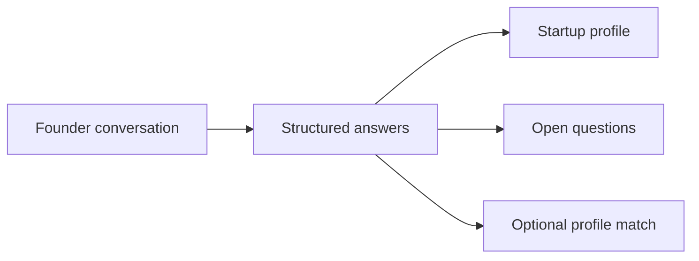

[Standalone diagram](diagrams/01-start-with-the-result.mmd)

**Speaker notes**

When I read the challenge, I started with the information we should have at the end: team, product, stage, traction, market, financing and next steps. A pleasant conversation matters, but the lasting value is a useful result that someone can review. That gave me a way to work backwards into the design.

**Demo action**

Open a completed interview report. Point to one answer, one open item and the separate completeness and match indicators.

**Source pointers**

- [app/analysis.py](../../app/analysis.py) — `analyze` (currently line 43): Builds the report from saved interview state.
- [frontend/src/InterviewReport.tsx](../../frontend/src/InterviewReport.tsx) — `InterviewReport` (currently line 8): Displays answers, scores and transcript evidence.

**Be precise about the limitation**

A match score exists only if an administrator configured criteria. It is not a general investment-quality rating.

**Transition:** To produce this result consistently, I first needed a data model.

## 2. Separate questions, answers and interviews

**Design question:** How do I keep records comparable and isolated?

**On-slide message:** Configuration describes what to learn; each interview stores its own answers and configuration snapshot.

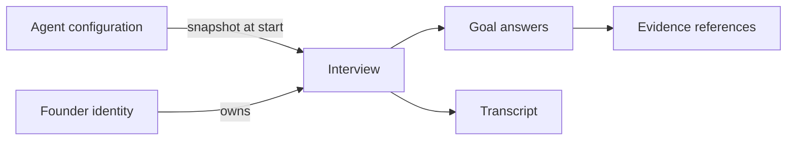

[Standalone diagram](diagrams/02-separate-questions-answers-and-interviews.mmd)

**Speaker notes**

I separated the questions from the answers. A question belongs to the configuration; an answer belongs to a specific interview. I also separated free text, categories and numbers. Team experience can remain descriptive, stage should use consistent categories, and funding needs require a number and currency. The configuration is saved with the interview so a later edit does not change how an old conversation is interpreted.

**Demo action**

Show a number goal and a choice goal in the admin interface, then the configuration version in a saved result.

**Source pointers**

- [app/goals.py](../../app/goals.py) — `AnswerGoal` (currently line 18): Question, sufficiency criteria, type and condition.
- [app/goals.py](../../app/goals.py) — `GoalAnswer` (currently line 73): Model-proposed answer with a quote.
- [app/goals.py](../../app/goals.py) — `GoalState` (currently line 83): Persisted answer progress.
- [app/models.py](../../app/models.py) — `Interview` (currently line 91): Owns configuration, answers, transcript and state.
- [app/main.py](../../app/main.py) — `start` (currently line 433): Creates an owned interview with a configuration snapshot.

**Be precise about the limitation**

The current system isolates records by founder and interview. It does not yet have a separate company master-data model or one company shared across multiple founder accounts.

**Transition:** Once the data structure was clear, I could decide which decisions actually need AI.

## 3. Give AI a bounded responsibility

**Design question:** Which work requires language understanding?

**On-slide message:** The model interprets language. Deterministic code controls validation, progression and persistence.

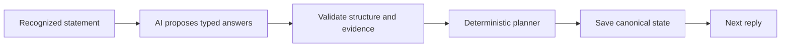

[Standalone diagram](diagrams/03-give-ai-a-bounded-responsibility.mmd)

**Speaker notes**

Founders should not have to speak like a form. They can mention several things at once or correct an earlier statement. The language model maps those statements into our answer schema. But the model does not decide whether a database write succeeded or whether it can ask indefinitely. Those are explicit rules. This also makes the central logic testable without microphones or paid services.

**Demo action**

Show Extraction and then the validation section of advance. Keep the rest of the code collapsed.

**Source pointers**

- [app/models.py](../../app/models.py) — `Extraction` (currently line 62): The constrained tool response schema.
- [voice/extraction.py](../../voice/extraction.py) — `extract` (currently line 17): Requests one structured interpretation.
- [app/planner.py](../../app/planner.py) — `advance` (currently line 104): Validates and applies the proposed answers.
- [app/store.py](../../app/store.py) — `SqliteStore` (currently line 23): Atomic persistence for local use.

**Be precise about the limitation**

Schema validity and exact quote presence do not prove the interpretation is semantically correct.

**Transition:** Next I needed to define what sufficient information means for each question.

## 4. Define answer goals and clarification rules

**Design question:** How do we know whether an answer is useful?

**On-slide message:** Each goal has sufficiency criteria and a bounded follow-up budget.

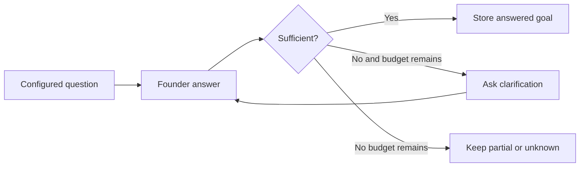

[Standalone diagram](diagrams/04-define-answer-goals-and-clarification-rules.mmd)

**Speaker notes**

A question list alone does not say whether we learned enough. For traction, “things are going well” should trigger a specific follow-up. “Two paying customers and 900 euros monthly revenue in September” is much more useful. The model evaluates the statement against configured criteria; the controller limits follow-ups. If the founder still cannot answer, the gap remains visible and we move on.

**Demo action**

Expand the traction goal. Show its criteria and clarification limit. Optionally answer vaguely in the text simulator, clearly identifying it as a controller demonstration rather than an AI test.

**Source pointers**

- [app/goals.py](../../app/goals.py) — `default_goals` (currently line 95): Initial questions and sufficiency criteria.
- [app/planner.py](../../app/planner.py) — `ask` (currently line 63): Tracks first questions and follow-ups.
- [app/planner.py](../../app/planner.py) — `select_next` (currently line 51): Enforces exhaustion and chooses a next goal.
- [frontend/src/GoalEditor.tsx](../../frontend/src/GoalEditor.tsx) — `GoalEditor` (currently line 2): Edits criteria and clarification budgets.
- [tests/test_goals.py](../../tests/test_goals.py): Regression examples for clarification and applicability.

**Be precise about the limitation**

The example decision diamond is conceptual: the LLM supplies the sufficiency classification and deterministic code enforces the budget. There is no separate deterministic semantic judge.

**Transition:** The order should be predictable without forcing the founder to speak in that order.

## 5. Guide a flexible conversation

**Design question:** How do we avoid repetition and irrelevant questions?

**On-slide message:** Ask the next relevant unanswered goal; retain information offered out of order.

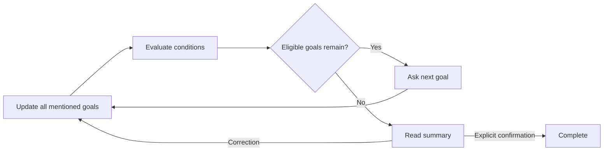

[Standalone diagram](diagrams/05-guide-a-flexible-conversation.mmd)

**Speaker notes**

The configured order is a guide. If the founder already explained the team while discussing the product, that information is retained. Conditional goals also matter: someone who is not raising money should not have to invent a funding round. When no eligible questions remain, the agent reviews the result. A correction creates a fresh review; simply stopping the microphone is not approval.

**Demo action**

Show a financing condition. In a prepared transcript, point out an early answer that prevented a repeated question and the final confirmation.

**Source pointers**

- [app/planner.py](../../app/planner.py) — `applicability` (currently line 23): Distinguishes relevant, excluded and unresolved conditions.
- [app/planner.py](../../app/planner.py) — `select_next` (currently line 51): Prioritizes relevant unanswered required goals.
- [app/planner.py](../../app/planner.py) — `advance` (currently line 104): Handles review, correction and confirmation.
- [app/interview.py](../../app/interview.py) — `stop_interview` (currently line 22): Marks unfinished sessions incomplete.

**Be precise about the limitation**

The normal questions and clarifications are configured text. The model does not freely invent every next question. General counterquestion handling is not yet a complete feature.

**Transition:** Because interpretation can be wrong, the result needs an audit trail.

## 6. Make answers traceable

**Design question:** How can someone check what the AI concluded?

**On-slide message:** Connect interpreted answers to recognized statements and preserve uncertainty.

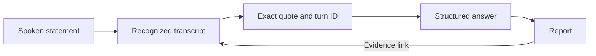

[Standalone diagram](diagrams/06-make-answers-traceable.mmd)

**Speaker notes**

I wanted a report that can be checked rather than a summary we simply trust. Every extracted answer needs evidence from the current recognized statement. The report links back to that contribution. We also distinguish an unknown answer from a negative match, and completeness from fit. A founder gets a spoken review so corrections can happen before completion.

**Demo action**

Click “Beleg ansehen” in the report and demonstrate transcript search. Show a missing criterion next to the coverage indicator.

**Source pointers**

- [app/planner.py](../../app/planner.py) — `advance` (currently line 104): Checks quote occurrence before applying answers.
- [app/main.py](../../app/main.py) — `worker_speech` (currently line 611): Persists actual spoken contributions and interruption flags.
- [app/analysis.py](../../app/analysis.py) — `analyze` (currently line 43): Derives match, coverage, completeness and chronology.
- [frontend/src/InterviewReport.tsx](../../frontend/src/InterviewReport.tsx) — `InterviewReport` (currently line 8): Links report claims back to transcript entries.

**Be precise about the limitation**

The transcript is recognized text, not raw audio. It may already contain STT mistakes. Merged multi-turn answers currently have limited evidence provenance.

**Transition:** Only after establishing the text-based logic did I need to choose the voice pipeline.

## 7. Connect text and voice through replaceable services

**Design question:** How does the same interview logic work with speech?

**On-slide message:** A media pipeline surrounds the domain controller; providers remain replaceable.

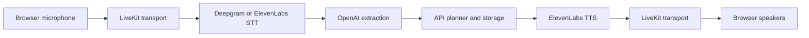

[Standalone diagram](diagrams/07-connect-text-and-voice-through-replaceable-services.mmd)

**Speaker notes**

Voice is a sequence of responsibilities: capture audio, recognize text, interpret the answer, decide the next step and generate speech. LiveKit handles the real-time session. A factory selects the speech recognizer; both provider plugins already expose the same internal interface. The worker talks to the backend instead of writing storage directly. That keeps conversation rules separate from provider choices.

**Demo action**

Show create_stt, then the AgentSession construction in the worker. Avoid opening .env or exposing keys.

**Source pointers**

- [voice/stt.py](../../voice/stt.py) — `create_stt` (currently line 8): Returns the selected implementation of the common STT interface.
- [voice/worker.py](../../voice/worker.py) — `entrypoint` (currently line 175): Assembles the LiveKit session.
- [voice/extraction.py](../../voice/extraction.py) — `Extractor` (currently line 11): Interprets recognized statements.
- [app/providers.py](../../app/providers.py) — `room_access` (currently line 12): Issues a room-scoped browser token.
- [app/config.py](../../app/config.py) — `Settings` (currently line 8): Server-side provider selection and credentials.

**Be precise about the limitation**

STT selection is currently server-wide, not an admin form field or a per-interview provider snapshot. Provider changes still need real speech tests.

**Transition:** The architecture then had to support conversational speed, not just correct output.

## 8. Optimize the response path

**Design question:** Where can we remove waiting without losing correctness?

**On-slide message:** One structured model call per turn; save before speaking; stream the audio.

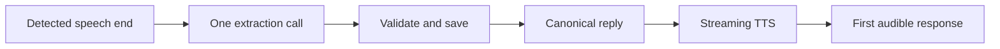

[Standalone diagram](diagrams/08-optimize-the-response-path.mmd)

**Speaker notes**

A voice interface feels slow even when an answer is technically correct if the pause is too long. I avoided a second model call just to produce a question: after saving the answer, the controller already knows the next reply. TTS then streams it. Turn-taking is another tradeoff. A shorter pause feels fast but may cut off a multi-part company name, so the name question gets extra patience.

**Demo action**

Show llm_node and endpointing_delay. Mention the real multi-part-name issue and its targeted regression test.

**Source pointers**

- [voice/worker.py](../../voice/worker.py) — `llm_node` (currently line 127): Extracts, persists and yields the canonical reply.
- [voice/worker.py](../../voice/worker.py) — `endpointing_delay` (currently line 44): Adds patience for the startup name.
- [voice/worker.py](../../voice/worker.py) — `agent_state` (currently line 234): Records a worker-side latency proxy.
- [voice/extraction.py](../../voice/extraction.py) — `Extractor` (currently line 11): Uses a bounded request without automatic model retries.
- [tests/test_voice.py](../../tests/test_voice.py): Tests sequencing, failures and endpointing policy.

**Be precise about the limitation**

This diagram is an ordered path, not a measured timing chart. The structured LLM response is not token-streamed. The worker metric is not browser speaker latency or a proven p95.

**Transition:** The user still needs clear control over when the microphone is active.

## 9. Design the startup interaction

**Design question:** How does a first-time founder know what to do?

**On-slide message:** Make entry, microphone feedback, start and stop explicit.

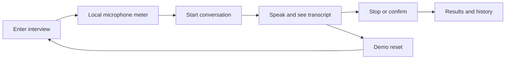

[Standalone diagram](diagrams/09-design-the-startup-interaction.mmd)

**Speaker notes**

The browser needs permission and visible feedback. A microphone test should show a level, not just confirm permission. During the interview, room connection and agent readiness are separate states. Stop releases microphone capture before waiting for persistence. The demo reset clears the active interface and gives the next interview a new context without deleting previous results.

**Demo action**

Let the audience see the meter respond, start a short conversation, and point out Stop. Use Reset only when you want to end that demonstration.

**Source pointers**

- [frontend/src/App.tsx](../../frontend/src/App.tsx) — `start` (currently line 45): Creates an interview and connects browser audio.
- [frontend/src/App.tsx](../../frontend/src/App.tsx) — `stop` (currently line 78): Releases microphone capture before saving the stop.
- [frontend/src/App.tsx](../../frontend/src/App.tsx) — `resetDemo` (currently line 85): Stops and reloads the local demo.
- [frontend/src/MicrophoneTest.tsx](../../frontend/src/MicrophoneTest.tsx) — `MicrophoneTest` (currently line 4): Local signal meter and resource cleanup.
- [frontend/e2e/microphone.spec.ts](../../frontend/e2e/microphone.spec.ts): Permission and cleanup tests.
- [frontend/e2e/reset.spec.ts](../../frontend/e2e/reset.spec.ts): Fresh-state reset and error-path tests.

**Be precise about the limitation**

The local meter measures signal energy, not speech intelligibility. Browser tests with simulated audio do not replace real-device testing.

**Transition:** Finally, I separated things an administrator should change from things that require code.

## 10. Configure behavior and then refine presentation

**Design question:** What should be editable without a deployment?

**On-slide message:** Version questions, criteria and voice settings; keep the UI focused on two roles.

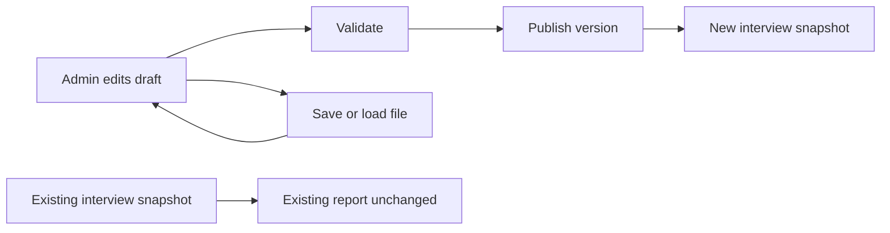

[Standalone diagram](diagrams/10-configure-behavior-and-then-refine-presentation.mmd)

**Speaker notes**

Administrators can change questions, sufficiency criteria, follow-up limits, voice settings and an optional target profile. Files let us keep different configurations, and publication makes activation explicit. React and TypeScript support interactive browser state; FastAPI and Pydantic provide validated backend contracts. SQLite makes local development easy, with a Firestore implementation for deployment. Visual design then makes those flows clear instead of driving the architecture.

**Demo action**

Select a preset voice, show save/load configuration, and point to “Version veröffentlichen”. Explain that a running interview retains its old version.

**Source pointers**

- [frontend/src/GoalEditor.tsx](../../frontend/src/GoalEditor.tsx) — `GoalEditor` (currently line 2): Question and answer-goal editing.
- [frontend/src/GoalEditor.tsx](../../frontend/src/GoalEditor.tsx) — `MatchEditor` (currently line 10): Optional target profile editing.
- [frontend/src/App.tsx](../../frontend/src/App.tsx) — `saveConfig` (currently line 104): Export current validated settings.
- [frontend/src/App.tsx](../../frontend/src/App.tsx) — `loadConfig` (currently line 111): Load a validated draft.
- [app/main.py](../../app/main.py) — `publish` (currently line 383): Version conflict checks and publication.
- [frontend/src/style.css](../../frontend/src/style.css): Visual hierarchy and responsive layout.
- [frontend/vite.config.ts](../../frontend/vite.config.ts): Frontend tooling and API proxy.
- [pyproject.toml](../../pyproject.toml): Python stack and dependency groups.

**Be precise about the limitation**

UI polish is not a substitute for the tested lifecycle. App.tsx remains concentrated; splitting pages and session hooks is sensible future work.

**Transition:** I can now explain the system through both its strengths and its remaining compromises.

## 11. Close with the tradeoff

**Design question:** What did this design prioritize?

**On-slide message:** Flexible language input with explicit state, evidence and transaction rules.

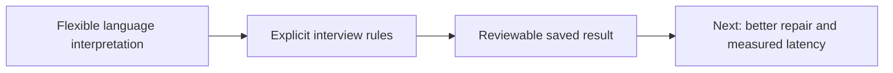

[Standalone diagram](diagrams/11-close-with-the-tradeoff.mmd)

**Speaker notes**

The central choice is to keep language interpretation flexible while keeping progression, storage and scoring explicit. That gives us a system we can inspect and test. The compromise is that structured collection is currently stronger than unrestricted conversation. My next priorities would be better counterquestion handling, richer evidence provenance and measured end-to-end latency across realistic voices and microphones.

**Demo action**

Return to the completed result from the opening slide. End on the useful output, not a terminal window.

**Source pointers**

- [docs/learning/APP_DEEP_DIVE.md](../../docs/learning/APP_DEEP_DIVE.md): Backend rationale and limitations.
- [docs/learning/FRONTEND_DEEP_DIVE.md](../../docs/learning/FRONTEND_DEEP_DIVE.md): Frontend rationale and limitations.
- [docs/LIVE_TEST_REPORT.md](../../docs/LIVE_TEST_REPORT.md): Recorded live-test evidence.

**Be precise about the limitation**

Present this as the reasoning behind the design, not a fabricated claim that every implementation step occurred in this order.

