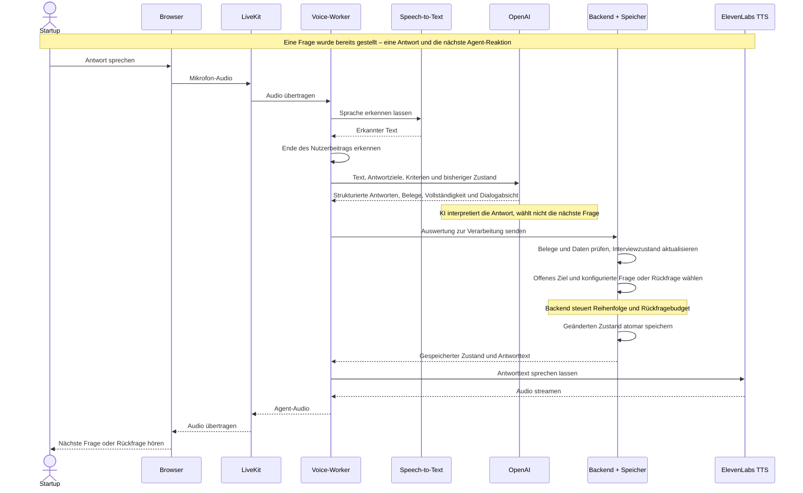

# Eine Frage-Antwort-Runde

Dieses vereinfachte Diagramm verbindet Folie 3 (KI interpretiert, Backend steuert) und Folie 7 (Sprachpipeline). Es beginnt nach einer bereits gestellten Frage und endet mit der nächsten Frage oder Rückfrage. Anmeldung, Verbindungsaufbau, Fehlerpfade, Transkript-Callbacks und Abschluss sind zur Übersicht ausgelassen.

- **Speech-to-Text:** Deepgram oder ElevenLabs, ausgewählt durch die STT-Factory.
- **OpenAI:** Ein strukturierter Aufruf pro Nutzerbeitrag. Die KI extrahiert Werte und Belege und beurteilt die inhaltliche Vollständigkeit. Sie kann eine kurze Bestätigung formulieren.
- **Backend + Speicher:** FastAPI, Planner und SQLite/Firestore sind hier zusammengefasst. Der Planner wählt den konfigurierten Fragetext. Änderungen werden vor Rückgabe gespeichert.
- **LiveKit:** Transportiert Audio in beide Richtungen. Der Worker koordiniert die Verarbeitung.
- **Streaming:** Die Audioantwort wird gestreamt. Der strukturierte OpenAI-Aufruf liefert keine Token-Streaming-Antwort.

Bei einer Korrektur zu einer früheren Angabe oder einer Verständnisfrage hält der Planner die aktuelle Frage offen, ohne ihr Rückfragebudget zu verbrauchen. Diese Sonderzweige zeigt das ausführliche Diagramm.

## Quellcode

- `frontend/src/App.tsx`: Mikrofon, LiveKit-Verbindung und Wiedergabe.
- `voice/worker.py`: `Interviewer.llm_node` und `entrypoint`.
- `voice/stt.py`: `create_stt`.
- `voice/extraction.py`: `Extractor.extract`.
- `app/main.py`: `worker_turn` und `mutate_interview`.
- `app/planner.py`: `advance`, `select_next`, `ask`.
- `app/store.py`: atomare Speicherung.
